<a id="top"></a>

<p align="center">
  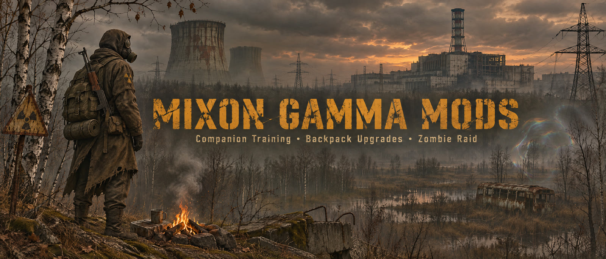
</p>

<p align="center"><a href="README.md">Русский</a> · <b>English</b></p>

<p align="center"><b>ModDB:</b>
<a href="https://www.moddb.com/mods/stalker-anomaly/addons/mixon-companion-training">Companion Training</a> ·
<a href="https://www.moddb.com/mods/stalker-anomaly/addons/mixon-backpack-upgrades">Backpack Upgrades</a> ·
<a href="https://www.moddb.com/mods/stalker-anomaly/addons/mixon-zombie-raid">Zombie Raid</a> ·
<a href="https://www.moddb.com/mods/stalker-anomaly/addons/mixon-carry-weight">Carry Weight</a></p>
<p align="center"><b>Author's Telegram:</b> <a href="https://t.me/nnw_ai">t.me/nnw_ai</a></p>


<h1 align="center">MIXON GAMMA MODS</h1>

<p align="center">
  <b>Four mods and a set of fixes for S.T.A.L.K.E.R. Anomaly — G.A.M.M.A.</b><br>
  <sub>Companions who learn and drag you back from the dead · backpacks with an upgrade tree · zombified raids · carry weight</sub>
</p>

<p align="center">
  
  
  
  
  
  <br>
  
  
  
  
</p>

> 📟 **PDA** · *incoming message* · **Mixon → all stalkers**
>
> I built what my own modpack was missing: companions who gain experience and pick you up when you go down, backpacks you can have a technician rework, and a horde of zombified for dessert. Patched a few other people's mods along the way. Tested on **GAMMA RC3** under **Mod Organizer 2**. Installs into a running save.

---

## ☢ CONTENTS

| | Section | What is inside |
|:-:|---|---|
| 01 | [Mods at a glance](#mods) | All four mods in one table |
| 02 | [Companion Training](#companion) | Perks, knockdown, medic, artefacts, banter, MCM, compatibility |
| 03 | [Backpack Upgrades](#backpack) | 4 classes, 5 branches, the full upgrade list |
| 04 | [Zombie Raid](#zombie) | Sizes, reward, random raids |
| 05 | [Carry Weight](#carry) | A 10–150 kg slider |
| 06 | [Installation (MO2)](#install) | Four steps and the requirements |
| 07 | [How to update](#update) | Replacing folders, record migration |
| 08 | [Fixes for other mods](#fixes) | Patch table and how to apply the patches |
| 09 | [FAQ](#faq) | Common questions |
| 10 | [Changelog](#changelog) | Companion Training: v1 → v9 |
| 11 | [Licence](#license) | Terms of use |

> 📟 **PDA** · *note* · The mods ship with both Russian and English text. Where the Russian game shows a different name, this page gives it in guillemets next to the English one, e.g. «Развитие напарников» (Companion Training). Voiced lines exist in Russian only.

---

<a id="mods"></a>

## ☢ MODS AT A GLANCE

| Mod | What it does | MCM page |
|---|---|---|
| **[Mixon Companion Training](mods/Mixon%20Companion%20Training)** | Companion progression: 7 perk branches, a PDA-style training window, a medic (medkits, antirad, vodka), player knockdown with a companion revive, artefact hunting, banter and jokes with Russian and English voice-over (3 voices each) | Companion Training · «Развитие напарников» |
| **[Mixon Backpack Upgrades](mods/Mixon%20Backpack%20Upgrades)** | Backpack upgrades at technicians: 4 backpack classes, 5 branches, +1 artefact slot, protection, ergonomics, rigging | Backpack Upgrades · «Улучшения рюкзаков» |
| **[Zombie Raid (Mixon)](mods/Zombie%20Raid%20%28Mixon%29)** | Zombified raids: on a hotkey or at random, 4 sizes, a "repel the attack" task, reward by kill count | Zombie raid (Mixon) · «Рейд зомбированных (Mixon)» |
| **[Carry Weight (Mixon)](mods/Carry%20Weight%20%28Mixon%29)** | Extra carry weight, 10–150 kg, a slider in MCM | Carry weight (Mixon) · «Переносимый вес (Mixon)» |

<p align="right"><a href="#top">▲ back to top</a></p>

---


### 🎮 In-game

| | |
|---|---|
| 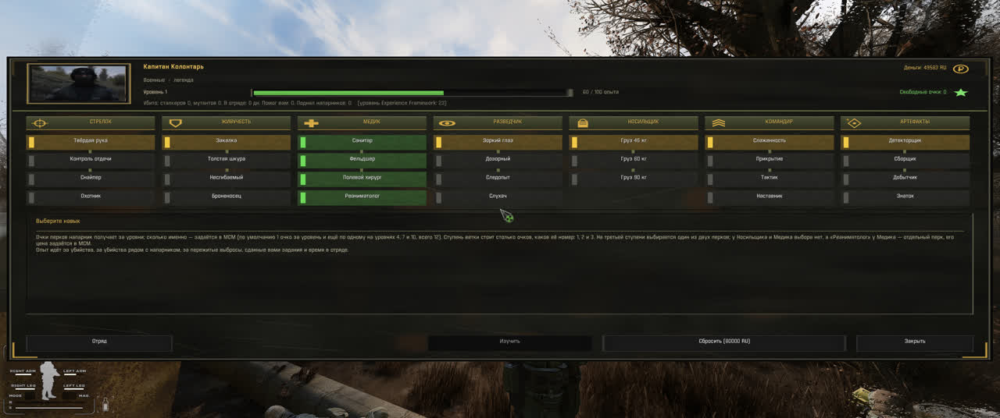 | 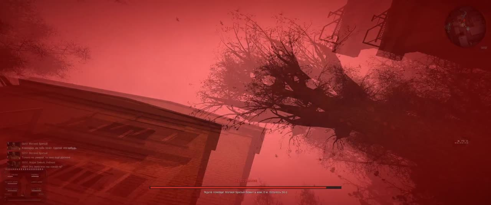 |
| PDA-style training window | Knockdown: you fall on your back, "help is coming, … runs to you" |
| 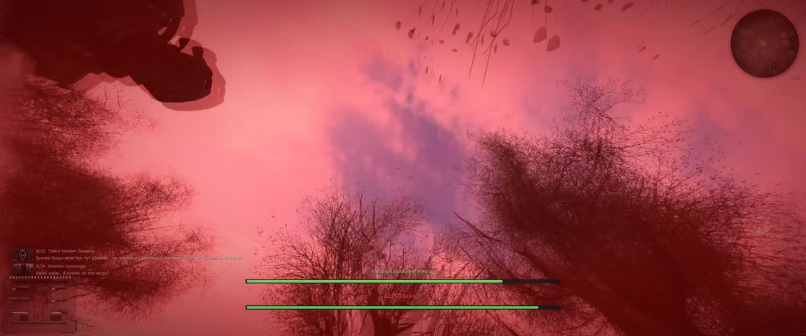 | 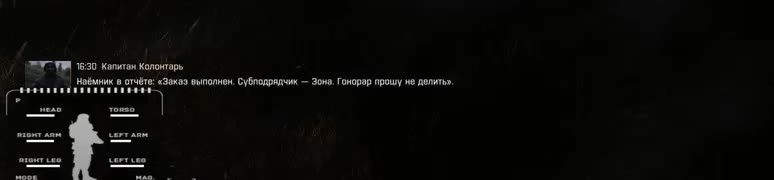 |
| The companion revives you: "Companion is helping you" and "UNCONSCIOUS" bars | A companion tells a joke |

🎬 Captioned videos: [companions](docs/media/game/companion_promo_en.mp4) · [backpacks](docs/media/game/backpack_promo_en.mp4) · [zombie raid](docs/media/game/zombie_raid_music_en.mp4) · [carry weight](docs/media/game/carry_promo_en.mp4)

🎬 Raw footage: [knockdown and revive](docs/media/game/knockdown_revive.mp4) · [training window and a joke](docs/media/game/companion_demo.mp4)

<a id="companion"></a>

<p align="center">
  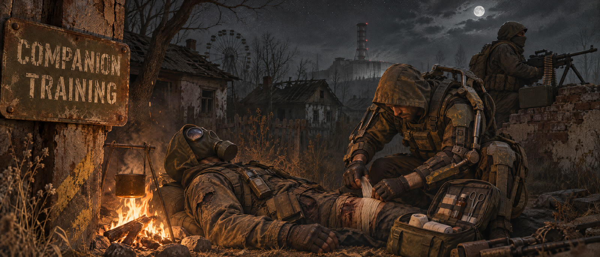
</p>

## ☢ COMPANION TRAINING

<p>
  
  
  
  
  
  
  
</p>

> 📟 **PDA** · *companion* · "I have learned a thing or two. Level 4, free points: 2."

🎬 **Video:** [training, MCM, knockdown and revive — 75 s](docs/media/game/companion_promo_en.mp4)

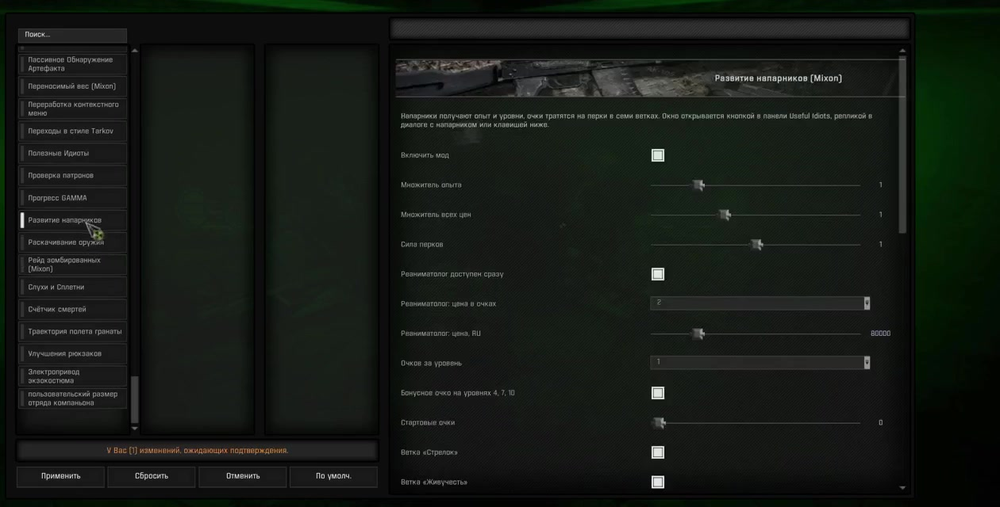

Companions earn experience and levels and spend points on perks in seven branches. The mod can be added to a running game: records for your current companions are created automatically.

### Opening the training window

| How | What happens |
|---|---|
| The three-chevron button in the header of the **Useful Idiots** panel | On a companion's tab it opens his tree, on the general tab — the squad list |
| A dialogue line: "Let's talk about your training." («Поговорим о твоей подготовке») | The same window; strangers do not have this line |
| A key from MCM (unbound by default) | The companion under your crosshair, or the squad list |

The window is drawn like a stalker PDA: portrait, level, XP bar, seven branch columns, a perk description on click, and Learn / Reset / Squad / Close at the bottom. The squad list has an "In memory" («Память») section — fallen companions with their level and kill count.

### Levels, points and prices

| | Tier 1 | Tier 2 | Tier 3 | Reanimator |
|---|:-:|:-:|:-:|:-:|
| **Points** | 1 | 2 | 3 | 4 |
| **Price** | 50,000 RU | 120,000 RU | 240,000 RU | 320,000 RU |

- There are **10** levels. Each level gives 1 point; levels 4, 7 and 10 give 2. That is **12 points** per companion.
- A full branch costs 6 points, the whole tree 46. There is not enough for everything: a companion has to specialise.
- Tier three is a choice of one perk out of two (**A** or **B**). Carrier and Medic have no choice.
- **Reset:** 80,000 RU × level, points are returned. The button is pressed twice — the second press confirms.
- Prices, experience and perk strength can be scaled with multipliers in MCM (price multiplier 0 means free).

### The perk tree

Russian in-game names are given in guillemets.

| Branch | Tier 1 | Tier 2 | Tier 3 · A | Tier 3 · B |
|---|---|---|---|---|
| **MARKSMAN** «Стрелок» | Steady hand «Твёрдая рука» | Recoil control «Контроль отдачи» | Sniper «Снайпер» | Hunter «Охотник» |
| **TOUGHNESS** «Живучесть» | Hardening «Закалка» | Thick skin «Толстая шкура» | Unbreakable «Несгибаемый» | Ironclad «Броненосец» |
| **MEDIC** «Медик» | Orderly «Санитар» | Paramedic «Фельдшер» | Field Surgeon «Полевой хирург» *(no choice)* | — |
| ↳ separate perk | | | **Reanimator** «Реаниматолог» *(needs tier 2, 4 points)* | |
| **SCOUT** «Разведчик» | Keen eye «Зоркий глаз» | Sentry «Дозорный» | Tracker «Следопыт» | Listener «Слухач» |
| **CARRIER** «Носильщик» | Load 45 kg | Load 60 kg | Load 90 kg *(no choice)* | — |
| **COMMANDER** «Командир» | Teamwork «Слаженность» | Covering fire «Прикрытие» | Tactician «Тактик» | Mentor «Наставник» |
| **ARTEFACTS** «Артефакты» | Dowser «Детекторщик» | Gatherer «Сборщик» | Prospector «Добытчик» | Connoisseur «Знаток» |

<details>
<summary><b>Expand: what every perk does</b></summary>

<br>

Numbers are for Perk strength ×1 in MCM.

**MARKSMAN**

| Perk | Tier | Effect |
|---|:-:|---|
| Steady hand | 1 | Firing dispersion ×0.90 |
| Recoil control | 2 | Dispersion ×0.80. Damage to stalkers +5% |
| Sniper | 3A | Dispersion ×0.60 while standing or crouching still, ×0.80 on the move. Damage to stalkers +10% |
| Hunter | 3B | Dispersion ×0.80. Damage to mutants +25% |

**TOUGHNESS**

| Perk | Tier | Effect |
|---|:-:|---|
| Hardening | 1 | Incoming damage ×0.92 |
| Thick skin | 2 | Incoming damage ×0.85. Wounds close faster |
| Unbreakable | 3A | Keeps the Thick skin effects. While the companion is downed: +50% time before death, +25% health after being revived. 40% chance that a non-lethal headshot does not drop him (60 s cooldown). Requires Companion Downed But Not Out |
| Ironclad | 3B | Incoming damage ×0.75. A further ×0.85 from mutants and explosions. Wounds close faster |

**MEDIC**

| Perk | Tier | Effect |
|---|:-:|---|
| Orderly | 1 | You are bleeding and the companion is within 6 m — he bandages you (uses a bandage from his own backpack if he has one; 180 s cooldown). "A hundred grams": at 25%+ radiation and out of combat he pours you vodka from his backpack; no vodka — once per 6 game hours from his personal stock. 180 s cooldown |
| Paramedic | 2 | Your health is below 40% and the companion is within 6 m — he uses a medkit from his backpack on you (and takes back what is left of a multi-use kit); no medkits — a basic one from his personal stock once per 12 game hours. 90 s cooldown. At 35%+ radiation and out of combat he gives you an antirad (from the backpack, or from the stock once per 12 hours), 120 s cooldown. Vodka only when there is no antirad |
| Field Surgeon | 3 | The personal stock refills every 6 game hours and gives an army medkit; the antirad from the stock is every 6 hours as well. Bandage cooldown 90 s. Companions within 20 m of him get +5% health every 10 s |
| **Reanimator** | separate | Needs Medic tier 2, 4 points, 320,000 RU. Compatible with Field Surgeon. The player can be knocked down instead of dying — see [Knockdown](#downed). Revives companions the same way: 8 s within 15 m, 50% health, 120 s cooldown (requires Companion Downed But Not Out) |

**SCOUT**

| Perk | Tier | Effect |
|---|:-:|---|
| Keen eye | 1 | Enemies the companion sees (up to 80 m) are marked on the minimap and in the PDA for 20 s |
| Sentry | 2 | The mark lasts 45 s. Reports first contact with a dangerous mutant or a group of three or more enemies (at most once a minute) |
| Tracker | 3A | Detection range 150 m. The mark tooltip shows the enemy's faction and rank |
| Listener | 3B | In "wait" and "cover" modes marks every enemy within 50 m, even without line of sight |

**CARRIER**

| Perk | Tier | Effect |
|---|:-:|---|
| Load 45 kg | 1 | The companion carries up to 45 kg of your things (instead of 30 kg) |
| Load 60 kg | 2 | Up to 60 kg |
| Load 90 kg | 3 | Up to 90 kg |

**COMMANDER** — the aura affects other companions, not the commander himself.

| Perk | Tier | Effect |
|---|:-:|---|
| Teamwork | 1 | 25 m aura: dispersion ×0.95, experience gained +10% |
| Covering fire | 2 | 25 m aura: dispersion ×0.95, incoming damage ×0.95, experience +20% |
| Tactician | 3A | 35 m aura: dispersion ×0.90, incoming damage ×0.90, experience +20% |
| Mentor | 3B | 25 m aura: dispersion ×0.95, incoming damage ×0.95, experience +20%. Companions below his level get a further +50% experience. The share of experience for a nearby kill rises from 30% to 60% |

**ARTEFACTS** — needs a detector in the companion's backpack. Radius by detector: Echo 15 m, Bear and Grizzly 25 m, Veles 35 m, Svarog 50 m.

| Perk | Tier | Effect |
|---|:-:|---|
| Dowser | 1 | Nearby artefacts are marked with a yellow dot on the minimap and in the PDA; the companion reports distance and direction |
| Gatherer | 2 | Radius ×1.5, the message and the mark show the artefact's name. An artefact within 15 m, out of combat, he retrieves himself in 20 s and puts into his backpack, condition +5%. 30 game minutes cooldown |
| Prospector | 3A | Radius ×2, retrieves from 25 m, 15 game minutes cooldown, condition +5%. 15% chance to find a second identical artefact nearby |
| Connoisseur | 3B | Radius ×1.5, condition of retrieved artefacts +15%. Artefacts and artefact containers in his backpack restore 1% condition per game hour, up to 60% |

Artefacts are not created out of thin air (apart from the Prospector bonus): only those actually lying on the level are picked up.

</details>

<details>
<summary><b>Expand: what a companion gets experience for</b></summary>

<br>

| Event | XP |
|---|:-:|
| Killing a stalker (by rank) | 10–75 |
| Killing a mutant (by size) | 8 / 22 / 60 |
| A kill by the player or another companion within 40 m | 30% of that |
| Emission or psi-storm | 40 |
| A task you hand in | 60 |
| An hour in the squad (up to 60 a day) | 5 |
| Artefact | 25 |
| Helping a wounded stalker | 20 |
| Medic help | 15 |
| Reviving someone who is down | 30 |
| Looting a corpse | 2 |

</details>

<a id="downed"></a>

### Knockdown: "UNCONSCIOUS"

> 📟 **PDA** · *companion* · "Hold on, I am coming! Stay with me."

A lethal hit does not kill you if a **Reanimator** is nearby — alive, on his feet and no further than 50 m away.

| Stage | What happens |
|---|---|
| **The fall** | You drop onto your back and the camera stares at the sky: a slight head bounce, breathing, a slow sway, blinking (more often as the timer runs out). Tunnel vision closes in, a bloody rim pulses, sound is muffled. At the bottom the **UNCONSCIOUS** («БЕЗ СОЗНАНИЯ») bar drains — 60 s |
| **While you are down** | Controls are off (Esc and the menu work), damage does not get through, stalkers do not finish you off |
| **The companion runs** | He drops his "wait / cover / patrol" orders, ignores enemies and danger (grenades, gunfire, corpses) and runs to you. From 5 m he moves in a crouch |
| **Treatment** | At about 2 m he kneels beside you, looks at you and gets you up in **8 s**. A green **"Your companion is helping you"** («Напарник оказывает помощь») bar is shown above the timer; while he works, the timer is paused |
| **Getting up** | You rise with 35% health: the camera comes up first, then controls and your weapon return |
| **Cooldown** | **4 game hours**, stored in the save. Go down again within that time and you die |

**Anti-stuck fallback.** If the companion cannot reach you (he is not getting closer or has been on his way too long), he teleports to you — only onto a verified AI-map vertex 1.2–1.8 m from you and at your height. If there is no such vertex, he does not teleport, so nobody falls through the ground. The timer gets +15 s when that happens.

**When you do die:** the timer ran out; no Reanimator is left nearby; the revive is on cooldown; an arena fight; death from an emission or psi-storm; the option is off in MCM. Ordinary death goes down the stock path, so Soulslike and other mods work as before.

Saving from the menu while you are down works: after loading, the state and the timer carry on.

### The medic

| Situation | Condition | What the companion does |
|---|---|---|
| Bleeding | Medic 1, within 6 m | Bandages you |
| Health below 40% | Medic 2, within 6 m | Uses a medkit on you — it works like a normal one (boosters, Body Health System body parts); the FDDA animation is not played |
| Radiation 25%+ | Medic 1, out of combat | Pours you vodka |
| Radiation 35%+ | Medic 2, out of combat | Gives an antirad; vodka only if there is no antirad |

Supplies come from the companion's backpack. If he has none, the "Medic's personal stock" helps out (can be switched off in MCM) — once every several game hours.

### Banter, jokes and voice-over

- **160 lines** in 21 categories and **42 jokes**. They arrive as a message with the companion's portrait.
- **Occasions:** medkit, bandage, antirad, vodka, the player going down and getting up, an artefact found and retrieved, a fight won, overweight, low health, rain, an emission starting and ending, night, a new location, waking up, you drinking vodka yourself, radiation with no medic around, idling.
- **Jokes** come when it is calm: more often at night, at a campfire and when you are crouching. There is also a "Tell me a joke" line in dialogue.
- **Invictus:** lines about it are only heard in a one-life game.
- One companion speaks at a time; lines do not repeat until the whole category has been used.
- **Voice-over (Russian + English):** 3 voices per line in each language. Russian: Vlad, Alexey I and Nester Surovy. English (with a Russian accent): Maxim, Petr and Alex. All generated with ElevenLabs. Each companion keeps his own voice. Language is set in MCM: "auto" uses the English voice when your game is in English.
- **"Booze the stalker"** («Спаивать сталкера») (MCM, off by default): every 15–120 game minutes a companion within 6 m, out of combat, treats you to vodka from his backpack.

| Voice | Sample |
|---|---|
| Vlad | [voice_vlad_vodka.ogg](docs/media/voice_vlad_vodka.ogg) |
| Alexey I | [voice_alexey_vodka.ogg](docs/media/voice_alexey_vodka.ogg) |
| Nester Surovy | [voice_nester_invictus.ogg](docs/media/voice_nester_invictus.ogg) |
| Maxim (EN) | [voice_en_maxim_vodka.ogg](docs/media/voice_en_maxim_vodka.ogg) |
| Petr (EN) | [voice_en_petr_invictus.ogg](docs/media/voice_en_petr_invictus.ogg) |
| Alex (EN) | [voice_en_alex_vodka.ogg](docs/media/voice_en_alex_vodka.ogg) |

<sub>GitHub does not embed a player for .ogg — the link opens or downloads the file.</sub>

Want your own voice-over? Put `.ogg` files into `gamedata\sounds\cup\banter\` named as in [`banter_lines_for_voice.csv`](mods/Mixon%20Companion%20Training/banter_lines_for_voice.csv) (UTF-8: `file_name, category, text_ru`). The text is shown either way.

### Screenshots

| Training window | Companion inventory |
|:-:|:-:|
| 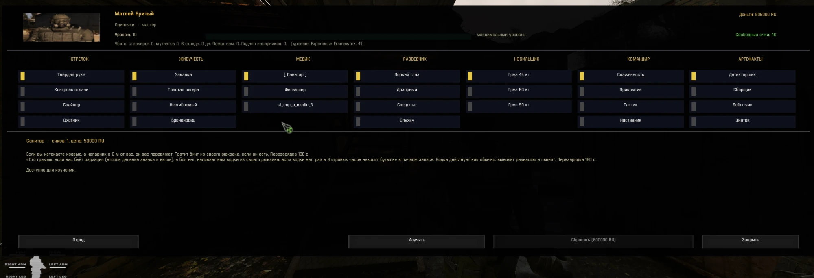 | 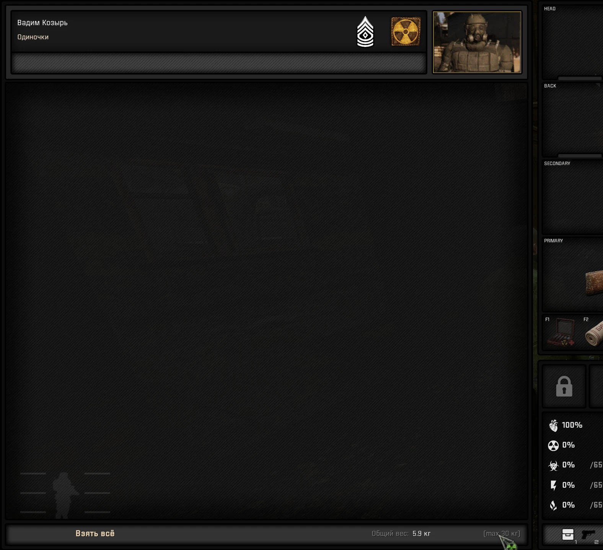 |
| <sub>Intermediate version, v4</sub> | <sub>The corrected weight-limit label</sub> |

A crash fixed during development: [screenshot](docs/media/bugfix_backpack_fatal.png) — `hit.wound_2` is `nil` in this engine, so tables are no longer indexed by engine constants.

### MCM · Companion Training «Развитие напарников»

<details>
<summary><b>Expand: all options</b></summary>

<br>

| Option | Default | What it does |
|---|:-:|---|
| Enable the mod | on | When off, no experience is awarded and perks do nothing. Progress stays in the save |
| Experience multiplier | 1 (0.25–4) | Multiplies all companion experience |
| Price multiplier | 1 (0–3) | Perk and reset prices; 0 means free |
| Perk strength | 1 (0.5–1.5) | How strongly the numeric perk effects apply |
| Marksman / Toughness / Medic / Scout / Carrier / Commander / Artefacts branch | on | A disabled branch has no effect and cannot be learned |
| Medic's personal stock | on | The medic can bandage without a bandage and, once every several hours, produce a medkit, antirad or vodka from his stock |
| Medic treats radiation with vodka | on | When off, he treats radiation with antirad only (from tier 2) |
| Booze the stalker | off | Companions regularly treat you to vodka, radiation or not |
| Booze: interval | 60 (15–120) game minutes | How often they pour |
| Companion banter | on | Comments on what is going on |
| Banter frequency | normal | off / rare / normal / often |
| Jokes | on | Jokes when it is calm, and the dialogue line |
| Voiced lines | on | Play the .ogg from the companion |
| The player can be knocked down | on | Knockdown with a Reanimator revive; off — you die as usual |
| Artefact hunter messages | on | Messages about found and retrieved artefacts; map marks stay |
| Level-up message | on | A message when a companion gains a level |
| Scout messages | on | Dangerous mutants and enemy groups; map marks stay |
| Button in the Useful Idiots panel | on | Takes effect after restarting the game |
| Link to Companion DBNO | on | Needed by Unbreakable and by companion revives; takes effect after loading a save |
| Training window key | unbound | The companion under your crosshair, or the squad list |
| Debug logging | off | `[CUP][dbg]` lines: experience, dispersion, medic actions |

</details>

### Compatibility

| Mod | How it fits |
|---|---|
| **Useful Idiots** | Training window button in the panel header |
| **Companion Downed But Not Out** | Bridge: Unbreakable, and the Reanimator reviving downed companions |
| **Body Health System** | The medic's medkit heals body parts too |
| **Experience Framework** | The EF level is shown in the companion's stats |
| **Soulslike** | Ordinary death goes down the stock path — the mod works as before |
| **Tougher NPCs** | Already reduces damage to companions; the multipliers stack multiplicatively |
| **FDDA** | No animation is played when the medic treats you |
| **Hiring through the G_FLAT dialogue** | Progress is carried over to the new companion |

The mod overwrites no one else's files. It adds no new items, sections or info portions — only the mod's own tables are written to the save.

<p align="right"><a href="#top">▲ back to top</a></p>

---

<a id="backpack"></a>

<p align="center">
  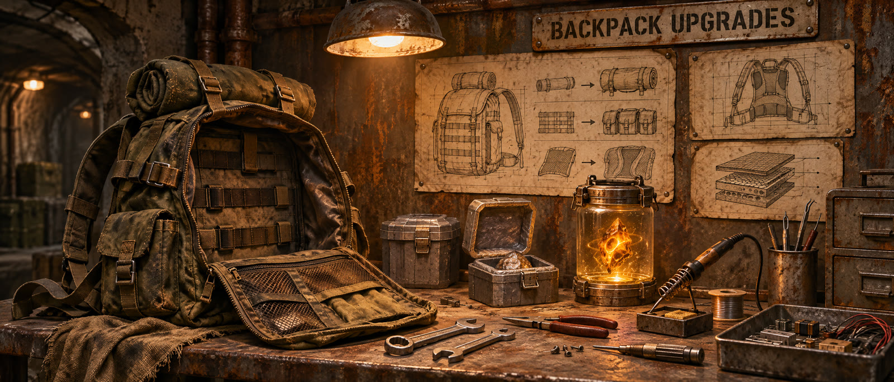
</p>

## ☢ BACKPACK UPGRADES

<p>
  
  
  
  
</p>

> 📟 **PDA** · *technician* · "A backpack is not a sack. Bring me a kit and I will make it worth carrying."

🎬 **Video:** [MCM and the mechanic's upgrade tree — 54 s](docs/media/game/backpack_promo_en.mp4)

| | |
|---|---|
| 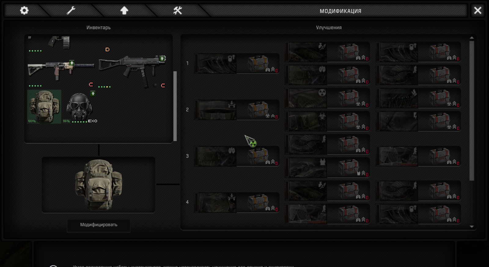 | 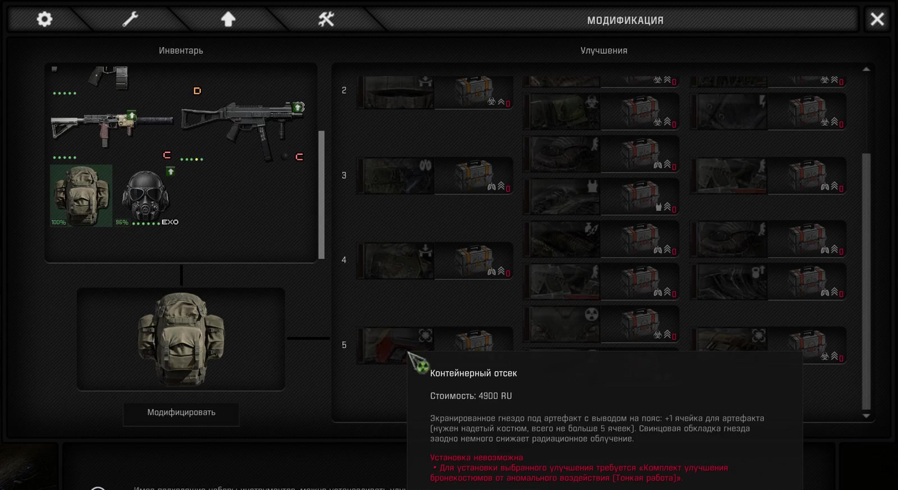 |
| Mechanic workbench: the tourist backpack's upgrade tree | Container Compartment: +1 artefact slot |

Backpacks get an upgrade tree at technicians and at the workbench. At each fork you pick one upgrade out of two. Only the upgrades of the backpack you are **wearing** apply.

### Backpack classes

| Class | Item sections | Base carry bonus | Kits for columns 1 / 2 / 3 |
|---|---|:-:|:-:|
| Light | `itm_backpack` | 21 kg | 1 / 1 / 2 |
| Medium | `equ_small_pack`, `equ_small_military_pack` | 28 kg, 34 kg | 1 / 2 / 2 |
| Heavy | `equ_military_pack` | 41 kg | 1 / 2 / 3 |
| Elite | `equ_tourist_pack` | 47 kg | 2 / 3 / 3 |

<sub>"Kits" is the upgrade-kit tier you need at the workbench.</sub>

<details>
<summary><b>Expand: all upgrades by branch</b></summary>

<br>

**CAPACITY**

| Upgrade | Effect | Excludes |
|---|---|---|
| Extra pockets | Slightly more carry weight | — |
| Expanded volume | Noticeably more carry weight | Lightweight frame |
| Lightweight frame | A slightly smaller weight bonus, but lower stamina drain on the move | Expanded volume |
| Cargo frame | The largest carry weight bonus | Compression straps |
| Compression straps | A small weight bonus and faster stamina recovery | Cargo frame |

**PROTECTION**

| Upgrade | Effect | Excludes |
|---|---|---|
| Protective impregnation | Slightly weakens radiation and chemical damage | — |
| Lead lining | Reduces radiation exposure | Chemical cover |
| Chemical cover | Reduces chemical burn damage | Lead lining |
| Thermal insulation | Reduces fire and heat damage | Dielectric layer |
| Dielectric layer | Reduces electric damage | Thermal insulation |

**ERGONOMICS**

| Upgrade | Effect | Excludes |
|---|---|---|
| Anatomic straps | Lower stamina drain on the move | — |
| Hip belt | Faster stamina recovery | Kevlar insert |
| Kevlar insert | Reduces damage from bullets, shrapnel and claws when hit in the back | Hip belt |
| Load distribution system | Substantially lower stamina drain | — |

**RIGGING**

| Upgrade | Effect | Excludes |
|---|---|---|
| Strap pouches | Faster magazine loading and unloading | — |
| Quick pockets | Faster weapon reload and magazine loading | Light suspension |
| Light suspension | Higher sprint and run speed | Quick pockets |
| Reinforced straps | Higher jump | Quick-access pouches |
| Quick-access pouches | Even faster magazine loading and a little more carry weight | Reinforced straps |

**COMPARTMENT**

| Upgrade | Effect | Excludes |
|---|---|---|
| Container compartment | **+1 artefact slot** (needs an outfit worn, 5 slots at most). Also slightly reduces radiation exposure | — |
| Lead compartment | Further reduces radiation exposure | Psi screen |
| Psi screen | Reduces psi influence | Lead compartment |
| Shielded module | Slightly reduces radiation exposure and psi influence | — |

<sub>The branch names here are informal — in game these are the five columns of the upgrade tree.</sub>

</details>

### MCM · Backpack Upgrades «Улучшения рюкзаков»

| Option | Default | What it does |
|---|:-:|---|
| Effect strength | 1 (0.5–1.5) | A common multiplier for all scripted effects |
| Damage protection | on | Radiation, chemical, fire, electricity, psi and the Kevlar insert |
| Stamina effects | on | Lower drain and faster recovery |
| Speed and jump | on | Sprint, run and jump height bonuses |
| Reload and magazines | on | Faster reloading and magazine loading (Mags Redux) |
| Extra artefact slot | on | +1 belt slot from the Container compartment |
| Debug logging | off | Total effects when the backpack or its upgrades change |

Backpack weight (kg) is set by configs and cannot be changed in MCM. The total reduction of any damage type is capped at 50%.

<p align="right"><a href="#top">▲ back to top</a></p>

---

<a id="zombie"></a>

<p align="center">
  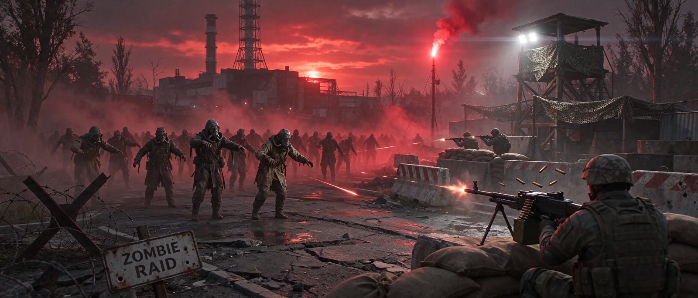
</p>

## ☢ ZOMBIE RAID

<p>
  
  
  
</p>

> 📟 **PDA** · *general channel* · "ATTENTION! A horde of zombified is closing in."

🎬 **Video:** [daytime raid on Zaton, captioned — 58 s](docs/media/game/zombie_raid_music_en.mp4)

| | |
|---|---|
| 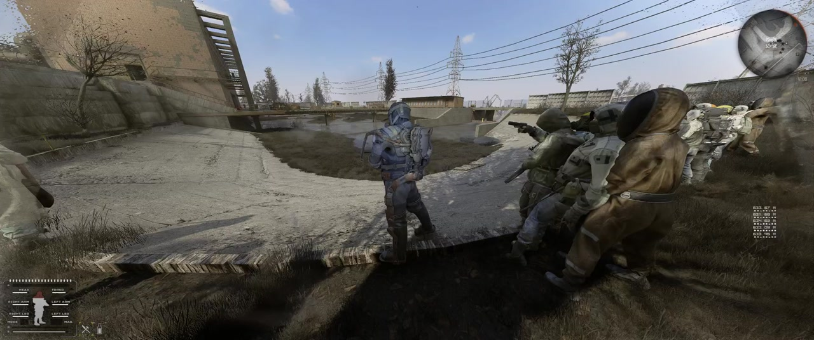 | 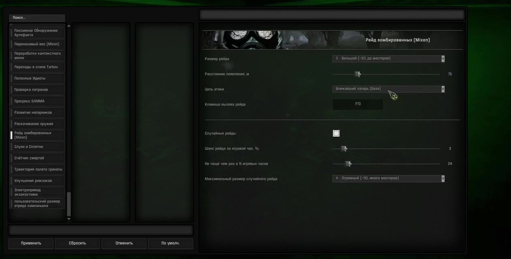 |
| The raid's main group | Raid settings in MCM |

The horde shows up on a hotkey (**F10** by default) or on its own, at random. It comes with the task **"Repel the zombified raid"** («Отбить атаку зомбированных») and a counter of those still standing.

| Size | Headcount | Composition |
|---|:-:|---|
| 1 — Light | ~10 | Novices and experienced |
| 2 — Medium | ~20 | Up to experts |
| 3 — Large *(default)* | ~50 | Up to masters |
| 4 — Huge | ~90 | Many masters |

**The reward is counted by kills:**

- every zombified is paid for by his rank; your own kills in full, your companions' kills at half;
- the larger the share of the horde your group took out, the more money, stashes (up to three) and goodwill with your own faction;
- a raid not repelled within 24 game hours is closed: half pay for the kills, no stashes.

### MCM · Zombie raid (Mixon) «Рейд зомбированных (Mixon)»

| Option | Default | Range |
|---|:-:|---|
| Raid size | 3 — Large | 1–4 |
| Spawn distance | 75 m | 30–250 m |
| Attack target | Nearest camp (base) | Camp / Player |
| Raid hotkey | F10 | — |
| Random raids | on | — |
| Raid chance per game hour | 3% | 1–30% |
| At most once per N game hours | 24 | 6–168 |
| Max random raid size | 4 — Huge | 1–4 |

Random raids do not start in undergrounds and labs, during an emission or psi-storm, while you sleep, or while the previous raid is still open. Small hordes come up more often than big ones.

<p align="right"><a href="#top">▲ back to top</a></p>

---

<a id="carry"></a>

<p align="center">
  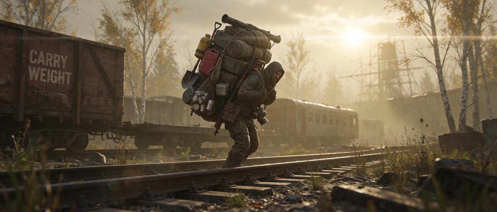
</p>

## ☢ CARRY WEIGHT

> 📟 **PDA** · *note* · "There is no such thing as too much loot. Only too little back."

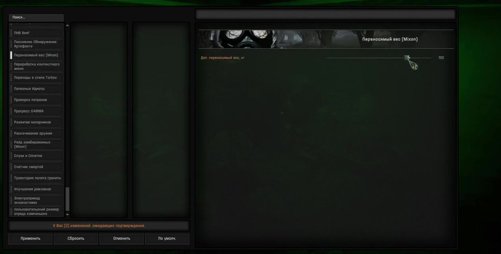

The simplest mod of the set: a single slider.

| MCM option | Default | Range |
|---|:-:|---|
| Extra carry weight, kg | 50 | 10–150, step 10 |

Applies at once, no reload needed. The bonus goes through the Experience Framework weight API (`weight.add_weight`).

<p align="right"><a href="#top">▲ back to top</a></p>

---

<a id="install"></a>

## ☢ INSTALLATION (MO2)

  


### Dependencies

| Mod | Required | Optional (detected automatically, all in GAMMA) |
|---|---|---|
| **Mixon Companion Training** | Anomaly 1.5.3 + Modded Exes (2024+), MCM | Useful Idiots (training button), Companion DBNO (Reanimator revives downed companions), Body Health System (limb healing), Experience Framework (companion level in the window), Soulslike, G_FLAT, Tougher Important NPCs |
| **Mixon Backpack Upgrades** | Anomaly 1.5.3 + Modded Exes (2024+, needed for the extra artefact slot), MCM | Experience Framework (sprint, jump and carry weight bonuses), a_pack Upgradeable Backpacks (compatibility patch included) |
| **Zombie Raid (Mixon)** | Anomaly 1.5.3, MCM | GAMMA heavy zombified squads (used in large raids if present) |
| **Carry Weight (Mixon)** | Experience Framework, MCM | — |

All required dependencies are part of G.A.M.M.A. — on GAMMA you don't need to install anything else.

1. Download the repository (**Code → Download ZIP**) and unpack it.
2. For each mod you want from the [`mods/`](mods) folder, copy the whole folder into `<GAMMA>\mods\`, e.g. `E:\GAMMA\GAMMA RC3\mods\Mixon Companion Training\` (there must be a `gamedata` folder inside).
3. Open MO2, press **F5** (refresh) and **enable** the mods with the checkbox. Place them **above** the other mods (higher priority) — the easiest way is to drag them to the very top of the list.
4. Start the game. Settings are in MCM: Companion Training, Backpack Upgrades, Zombie raid (Mixon), Carry weight (Mixon).

```text
<GAMMA>\mods\
├── Mixon Companion Training\
│   ├── gamedata\
│   └── meta.ini
├── Mixon Backpack Upgrades\
├── Zombie Raid (Mixon)\
└── Carry Weight (Mixon)\
```

> 📟 **PDA** · *important* · After updating xml or textures the game has to be restarted **completely** (quit to Windows): loading a save only reloads scripts.

<p align="right"><a href="#top">▲ back to top</a></p>

---

<a id="update"></a>

## ☢ HOW TO UPDATE

1. Close the game completely.
2. Get the latest version of the repository (**Code → Download ZIP**; if you cloned it — `git pull`).
3. Replace the mod folders in `<GAMMA>\mods\` with the new ones. Order and checkboxes in MO2 are kept.
4. Start the game again and load your save.

Companion records from older Companion Training versions are recalculated automatically on first load (the log shows `[CUP] migration ...` lines). If the perks already bought do not fit the new point costs, all perks are reset and the points returned; money is not refunded.

<p align="right"><a href="#top">▲ back to top</a></p>

---

<a id="fixes"></a>

<p align="center">
  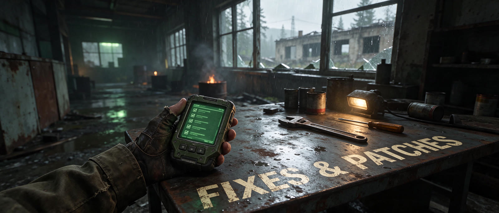
</p>

## ☢ FIXES FOR OTHER MODS

> 📟 **PDA** · *technician* · "Did not rewrite anyone's work. Only fixed what was crashing."

The patches are in [`patches/`](patches) in `diff` format. Apply them from the `mods` folder of your modpack:

```bash
cd "E:/GAMMA/GAMMA RC3/mods"
git apply -p1 C:/path/to/patches/tlra_valid_vertex_id_fix.diff
```

If the mod folder has a different name on your side (Dirt & Wear, for example), correct the path in the first lines of the diff or change the lines by hand: the diff shows exactly what to change. **Back up the file before applying.**

<details open>
<summary><b>Fix table</b></summary>

<br>

| Mod | Problem | Fix |
|---|---|---|
| **The Long Road Ahead 2.3.1** | Crash `zzzz_the_long_road_ahead.script:3562: attempt to call field 'valid_vertex_id' (a nil value)` when companions are teleported | [`tlra_valid_vertex_id_fix.diff`](patches/tlra_valid_vertex_id_fix.diff): the check is only called if the function exists in the engine |
| **G.A.M.M.A. ZCP 1.4 Balanced Spawns** | Busy Hands: `smr_pop.script(1182) : add_random_npc_to_squad` while spawning squads, game saved to tempsave | [`gamma_zcp_1.4_register_member_fix.diff`](patches/gamma_zcp_1.4_register_member_fix.diff): if the created object cannot join the squad, the spawn is dropped instead of crashing the script engine |
| **Weird Tasks Framework** (GAMMA) | PDA message "Weird Tasks Framework crashed! Sorry :(", log shows `_g.script:2062: attempt to compare number with boolean` from `alife_object` when opening a task dialog | [`wtf_missing_target_fix.diff`](patches/wtf_missing_target_fix.diff): a task whose target is gone is skipped quietly instead of reporting a crash |
| **Dirt & Wear** | Timer and restore errors, shader conflict with SSS23/Atmospherics | [`dirt_wear_fix.diff`](patches/dirt_wear_fix.diff), [`dirt_shake_weapon_fix.diff`](patches/dirt_shake_weapon_fix.diff) (scripts). The shaders have to be merged with the SSS23/Atmospherics versions by hand |
| **Companion anti awol 1.1.2** | Broken/untranslated strings in the Russian localisation | [`companion_anti_awol_rus_fix.diff`](patches/companion_anti_awol_rus_fix.diff) (the file is cp1251) |
| **LootBoxes GAMMA** | Typo `arcade_token` instead of `arcade_tokens` in the tool settings | Correct the section name in `configs/items/settings/lootbox_tools.ltx` |
| **trader_autoinject** (old copies) | Two versions of `trader_autoinject.script` conflict | Keep one copy, the newest; disable the old ones in MO2 |
| **Anomalous Creation** | Double spawn and a crash on a `nil` physics shell | A `nil` check on `get_physics_shell()` and a guard against repeated spawning |
| **MCP Bridge (stalker-mcp)** | Under the MSIX build of Claude Desktop the bridge folder is virtualised and the bridge cannot see the files | The bridge path is moved to `$app_data_root$\mcp_bridge\` (the mod is licensed CC BY-NC-ND — the patch is not published, only described) |

</details>

> 📟 **PDA** · *observation* · The Lockpick Set («Набор отмычек») from LootBoxes is a **passive** item — you do not open it. It makes boxes easier to crack; what gets used up are the individual lockpicks.

<p align="right"><a href="#top">▲ back to top</a></p>

---

<a id="faq"></a>

## ☢ FAQ

<details>
<summary><b>I changed the mod files but nothing changed in game</b></summary>

<br>

Loading a save only reloads scripts. After updating xml or textures you need a full game restart — quit to Windows.

</details>

<details>
<summary><b>Do I need a new game?</b></summary>

<br>

No. The mods install into existing saves; records for your current companions are created automatically.

</details>

<details>
<summary><b>I was killed and there was no knockdown</b></summary>

<br>

Knockdown only triggers if a companion with the Reanimator perk is nearby: alive, on his feet and no further than 50 m away. Without him death is ordinary. It also does not trigger in the arena, on death from an emission or psi-storm, during the cooldown, or if "The player can be knocked down" is off in MCM.

</details>

<details>
<summary><b>How often can a companion get me up?</b></summary>

<br>

Once every 4 game hours. The cooldown is stored in the save and the time left is shown in the perk description. Go down again within that time and you die.

</details>

<details>
<summary><b>The companion is stuck and cannot reach me</b></summary>

<br>

The fallback kicks in: he teleports onto a verified AI-map vertex next to you and the timer gets +15 s. If there is no suitable vertex, he does not teleport.

</details>

<details>
<summary><b>How do I open the Lockpick Set?</b></summary>

<br>

You do not — it is a passive item from LootBoxes. It makes boxes easier to crack; what gets used up are the individual lockpicks.

</details>

<details>
<summary><b>There are not enough points for every branch</b></summary>

<br>

By design: a level 10 companion has 12 points and the whole tree costs 46. Perks can be reset (80,000 RU × level) and redistributed, and prices can be changed with the MCM multiplier.

</details>

<details>
<summary><b>The companion does not look for artefacts</b></summary>

<br>

Put a detector into his backpack: Echo, Bear, Grizzly, Veles or Svarog. The detector sets the search radius.

</details>

<details>
<summary><b>The Unbreakable perk is unavailable</b></summary>

<br>

It needs the Companion Downed But Not Out mod and the "Link to Companion DBNO" option enabled in MCM.

</details>

<details>
<summary><b>How do I remove Companion Training?</b></summary>

<br>

Close the training window, save, disable the mod in MO2. The save will load; the mod's data simply stops being read. Before removing it, take the extra load off your carriers — the limit goes back to 30 kg. Do not save while lying knocked down: otherwise you will have to set the companion's "wait" and "ignore combat" orders again by hand.

</details>

<p align="right"><a href="#top">▲ back to top</a></p>

---

<a id="changelog"></a>

## ☢ CHANGELOG

Milestones of **Mixon Companion Training**. Details (in Russian) are in [`README_RU.txt`](mods/Mixon%20Companion%20Training/README_RU.txt).

| Version | What was added |
|:-:|---|
| **v11** | English voice-over: all 244 banter lines and jokes voiced by 3 Russian-accented English voices. New MCM option "Voice language" (auto / Russian / English). The second Vlad take was removed from the Russian voice-over |
| **v9** | Nobody falls through the ground: the Reanimator only teleports onto a verified AI-map vertex 1.2–1.8 m from the player. On his way the companion ignores danger. The lying camera no longer sinks into the ground or a slope |
| **v8** | Revive at arm's length: from 5 m the companion moves in a crouch, kneels beside you and stays that way to the end. The green "Your companion is helping you" bar |
| **v7** | The Reanimator is guaranteed to arrive: a "go to point" order every tick, he does not see enemies, teleport fallback, +15 s on the timer |
| **v6** | Falling onto your back: the camera stares at the sky, breathing, swaying, blinking; a smooth rise |
| **v5** | Prices ×2 (50,000 / 120,000 / 240,000 RU). Reanimator becomes a separate perk for 4 points and 320,000 RU, Medic tier 3 is Field Surgeon. The window is redrawn in PDA style |
| **v4** | Companion banter and jokes: 160 lines, 42 jokes, voice-over support. The "Booze the stalker" option |
| **v3** | Medic and radiation: vodka ("A hundred grams") and antirad |
| **v2** | Prices ×10, tiers cost 1 / 2 / 3 points. The medic applies a medkit himself. Player knockdown. The Artefacts branch |
| **v1** | The base: experience, 10 levels, six perk branches, the training window, the Useful Idiots button, the Companion DBNO bridge, MCM |

<p align="right"><a href="#top">▲ back to top</a></p>

---

<a id="license"></a>

## ☢ LICENCE

- **Code and texts of the Mixon mods** — free for non-commercial use in S.T.A.L.K.E.R. modpacks.
- **Voice-over** was generated with ElevenLabs.
- **Other people's mods** belong to their authors; only patches and descriptions are here.

---

<p align="center">
  <sub>Good hunting, stalker.</sub><br>
  <sub>MIXON · THE ZONE · GAMMA RC3</sub>
</p>
