<a id="top"></a>

<p align="center">
  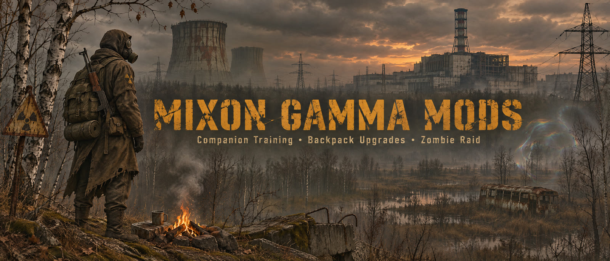
</p>

<p align="center"><b>Русский</b> · <a href="README.en.md">English</a></p>

<p align="center"><b>ModDB:</b>
<a href="https://www.moddb.com/mods/stalker-anomaly/addons/mixon-companion-training">Companion Training</a> ·
<a href="https://www.moddb.com/mods/stalker-anomaly/addons/mixon-backpack-upgrades">Backpack Upgrades</a> ·
<a href="https://www.moddb.com/mods/stalker-anomaly/addons/mixon-zombie-raid">Zombie Raid</a> ·
<a href="https://www.moddb.com/mods/stalker-anomaly/addons/mixon-carry-weight">Carry Weight</a></p>
<p align="center"><b>Telegram автора:</b> <a href="https://t.me/nnw_ai">t.me/nnw_ai</a></p>


<h1 align="center">MIXON GAMMA MODS</h1>

<p align="center">
  <b>Четыре мода и набор исправлений для S.T.A.L.K.E.R. Anomaly — G.A.M.M.A.</b><br>
  <sub>Напарники, которые учатся и вытаскивают с того света · рюкзаки с деревом улучшений · рейды зомбированных · переносимый вес</sub>
</p>

<p align="center">
  
  
  
  
  
  <br>
  
  
  
  
</p>

> 📟 **КПК** · *входящее сообщение* · **Mixon → всем сталкерам**
>
> Собрал для своей сборки то, чего не хватало: напарников, которые набираются опыта и поднимают упавшего, рюкзаки, которые можно дорабатывать у техника, и орду зомбированных на закуску. Заодно залатал несколько чужих модов. Проверено на **GAMMA RC3** под **Mod Organizer 2**. Ставится на идущее сохранение.

---

## ☢ СОДЕРЖАНИЕ

| | Раздел | Что внутри |
|:-:|---|---|
| 01 | [Сводка модов](#mods) | Четыре мода одной таблицей |
| 02 | [Подготовка напарников](#companion) | Перки, нокдаун, медик, артефакты, фразы, MCM, совместимость |
| 03 | [Апгрейды рюкзаков](#backpack) | 4 класса, 5 веток, полный список улучшений |
| 04 | [Рейд зомбированных](#zombie) | Размеры, награда, случайные рейды |
| 05 | [Переносимый вес](#carry) | Ползунок 10–150 кг |
| 06 | [Установка (MO2)](#install) | Четыре шага и требования |
| 07 | [Как обновить](#update) | Замена папок и миграция записей |
| 08 | [Исправления к чужим модам](#fixes) | Таблица патчей и как их применять |
| 09 | [FAQ](#faq) | Частые вопросы |
| 10 | [Changelog](#changelog) | Companion Training: v1 → v9 |
| 11 | [Лицензия](#license) | Условия использования |

---

<a id="mods"></a>

## ☢ СВОДКА МОДОВ

| Мод | Что делает | Страница MCM |
|---|---|---|
| **[Mixon Companion Training](mods/Mixon%20Companion%20Training)** | Прокачка напарников: 7 веток перков, окно подготовки в стиле КПК, медик (аптечки, антирад, водка), нокдаун игрока с подъёмом напарником, поиск артефактов, фразы и анекдоты с озвучкой (4 голоса) | «Развитие напарников» |
| **[Mixon Backpack Upgrades](mods/Mixon%20Backpack%20Upgrades)** | Апгрейды рюкзаков у техников: 4 класса рюкзаков, 5 веток, +1 ячейка артефакта, защита, эргономика, подвеска | «Улучшения рюкзаков» |
| **[Zombie Raid (Mixon)](mods/Zombie%20Raid%20%28Mixon%29)** | Рейды зомбированных: по клавише или случайно, 4 размера, квест «отбить атаку», награда по числу убитых | «Рейд зомбированных (Mixon)» |
| **[Carry Weight (Mixon)](mods/Carry%20Weight%20%28Mixon%29)** | Доп. переносимый вес 10–150 кг, ползунок в MCM | «Переносимый вес (Mixon)» |

<p align="right"><a href="#top">▲ наверх</a></p>

---


### 🎮 Из игры

| | |
|---|---|
| 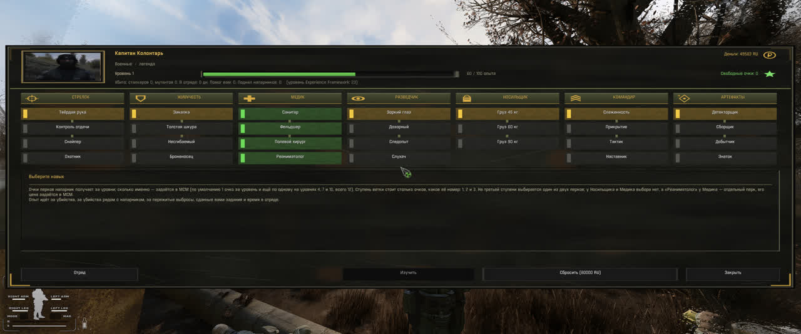 | 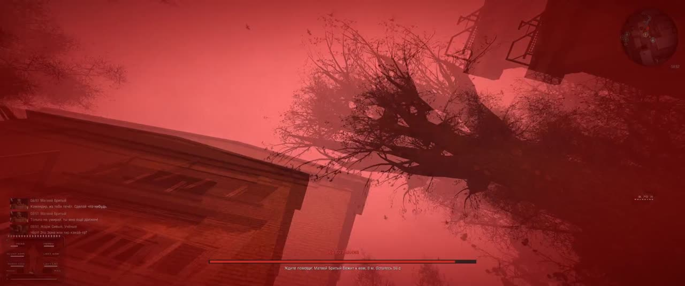 |
| Окно подготовки в стиле КПК | Нокдаун: падение на спину, «Ждите помощи: … бежит к вам» |
| 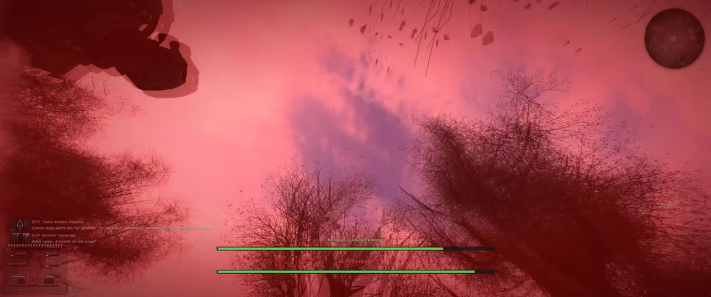 | 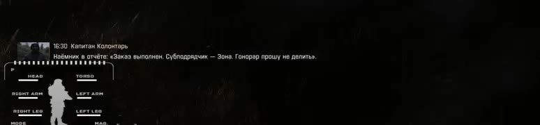 |
| Напарник поднимает: полосы «Напарник оказывает помощь» и «БЕЗ СОЗНАНИЯ» | Напарник травит анекдот |

🎬 Видео: [нокдаун и подъём](docs/media/game/knockdown_revive.mp4) · [окно подготовки и анекдот](docs/media/game/companion_demo.mp4)

<a id="companion"></a>

<p align="center">
  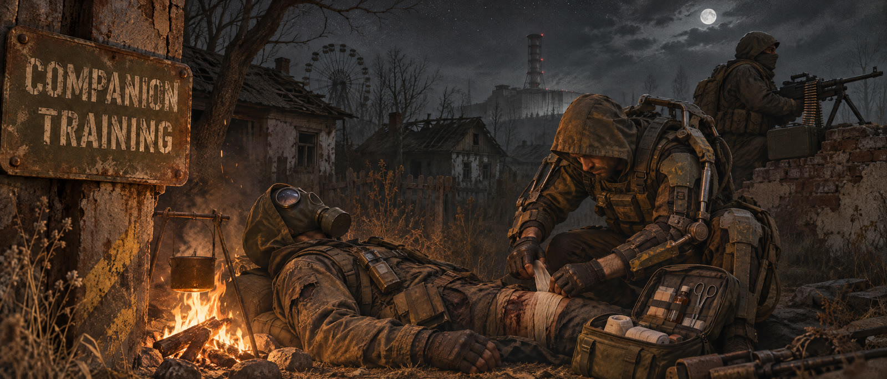
</p>

## ☢ ПОДГОТОВКА НАПАРНИКОВ

<p>
  
  
  
  
  
  
  
</p>

> 📟 **КПК** · *напарник* · «Я набрался опыта. Уровень 4, свободных очков: 2.»

Напарники получают опыт и уровни, а очки тратят на перки в семи ветках. Мод ставится в идущую игру: записи для текущих напарников создаются сами.

### Как открыть окно подготовки

| Способ | Что происходит |
|---|---|
| Кнопка с тремя шевронами в заголовке панели **Useful Idiots** | На вкладке напарника открывает его дерево, на общей вкладке — список отряда |
| Реплика в диалоге: «Поговорим о твоей подготовке» | То же окно; у чужих сталкеров реплики нет |
| Клавиша из MCM (по умолчанию не назначена) | Напарник под прицелом или список отряда |

Окно нарисовано в стиле сталкерского КПК: портрет, уровень, полоса опыта, семь столбцов веток, описание перка по щелчку, внизу — «Изучить», «Сбросить», «Отряд», «Закрыть». В списке отряда есть раздел «Память» — погибшие напарники с уровнем и счётом убийств.

### Уровни, очки и цены

| | Ступень 1 | Ступень 2 | Ступень 3 | «Реаниматолог» |
|---|:-:|:-:|:-:|:-:|
| **Очки** | 1 | 2 | 3 | 4 |
| **Цена** | 50 000 RU | 120 000 RU | 240 000 RU | 320 000 RU |

- Уровней **10**. Каждый уровень даёт 1 очко, уровни 4, 7 и 10 — по 2. Всего **12 очков** на напарника.
- Полная ветка стоит 6 очков, всё дерево — 46. На всё не хватит: напарника придётся специализировать.
- На третьей ступени выбирается один перк из двух (**A** или **B**). У Носильщика и Медика выбора нет.
- **Сброс:** 80 000 RU × уровень, очки возвращаются. Кнопка нажимается дважды — второе нажатие подтверждает.
- Цены, опыт и силу перков можно менять множителями в MCM (множитель цен 0 — бесплатно).

### Дерево перков

| Ветка | Ступень 1 | Ступень 2 | Ступень 3 · A | Ступень 3 · B |
|---|---|---|---|---|
| **СТРЕЛОК** | Твёрдая рука | Контроль отдачи | Снайпер | Охотник |
| **ЖИВУЧЕСТЬ** | Закалка | Толстая шкура | Несгибаемый | Броненосец |
| **МЕДИК** | Санитар | Фельдшер | Полевой хирург *(без выбора)* | — |
| ↳ отдельный перк | | | **Реаниматолог** *(нужна ступень 2, 4 очка)* | |
| **РАЗВЕДЧИК** | Зоркий глаз | Дозорный | Следопыт | Слухач |
| **НОСИЛЬЩИК** | Груз 45 кг | Груз 60 кг | Груз 90 кг *(без выбора)* | — |
| **КОМАНДИР** | Слаженность | Прикрытие | Тактик | Наставник |
| **АРТЕФАКТЫ** | Детекторщик | Сборщик | Добытчик | Знаток |

<details>
<summary><b>Развернуть: что делает каждый перк</b></summary>

<br>

Числа даны для «Силы перков» ×1 в MCM.

**СТРЕЛОК**

| Перк | Ступень | Эффект |
|---|:-:|---|
| Твёрдая рука | 1 | Разброс при стрельбе ×0,90 |
| Контроль отдачи | 2 | Разброс ×0,80. Урон по сталкерам +5% |
| Снайпер | 3A | Разброс ×0,60, когда стоит или сидит на месте, и ×0,80 в движении. Урон по сталкерам +10% |
| Охотник | 3B | Разброс ×0,80. Урон по мутантам +25% |

**ЖИВУЧЕСТЬ**

| Перк | Ступень | Эффект |
|---|:-:|---|
| Закалка | 1 | Входящий урон ×0,92 |
| Толстая шкура | 2 | Входящий урон ×0,85. Раны затягиваются быстрее |
| Несгибаемый | 3A | Сохраняет эффекты «Толстой шкуры». Когда напарник выведен из строя: время до смерти +50%, после подъёма +25% здоровья. 40% шанс, что несмертельное попадание в голову не уложит его (перезарядка 60 с). Требует Companion Downed But Not Out |
| Броненосец | 3B | Входящий урон ×0,75. От мутантов и взрывов дополнительно ×0,85. Раны затягиваются быстрее |

**МЕДИК**

| Перк | Ступень | Эффект |
|---|:-:|---|
| Санитар | 1 | Вы истекаете кровью, напарник в 6 м — перевяжет (тратит бинт из своего рюкзака, если он есть; перезарядка 180 с). «Сто грамм»: при радиации от 25% вне боя наливает водки из своего рюкзака; нет водки — раз в 6 игровых часов из личного запаса. Перезарядка 180 с |
| Фельдшер | 2 | Здоровье ниже 40%, напарник в 6 м — сам применяет на вас аптечку из своего рюкзака (остаток многоразовой забирает обратно); нет аптечек — обычная из личного запаса раз в 12 игровых часов. Перезарядка 90 с. При радиации от 35% вне боя даёт антирад (из рюкзака или из запаса раз в 12 часов), перезарядка 120 с. Водку наливает, только когда антирада нет |
| Полевой хирург | 3 | Личный запас пополняется раз в 6 игровых часов и даёт армейскую аптечку; антирад из запаса — тоже раз в 6 часов. Перезарядка перевязки 90 с. Напарники в 20 м от него получают +5% здоровья каждые 10 с |
| **Реаниматолог** | отдельный | Нужна ступень 2 Медика, 4 очка, 320 000 RU. Совместим с «Полевым хирургом». Игрока можно вывести из строя вместо смерти — см. [«Нокдаун»](#downed). Напарников поднимает так же: 8 с в 15 м, 50% здоровья, перезарядка 120 с (нужен Companion Downed But Not Out) |

**РАЗВЕДЧИК**

| Перк | Ступень | Эффект |
|---|:-:|---|
| Зоркий глаз | 1 | Враги, которых напарник видит (до 80 м), отмечаются на миникарте и в КПК на 20 с |
| Дозорный | 2 | Метка держится 45 с. Сообщает о первом контакте с опасным мутантом или с группой от трёх врагов (не чаще раза в минуту) |
| Следопыт | 3A | Дальность обнаружения 150 м. В подсказке метки видны группировка и ранг врага |
| Слухач | 3B | В режимах «ждать» и «укрытие» отмечает всех врагов в 50 м, даже без прямой видимости |

**НОСИЛЬЩИК**

| Перк | Ступень | Эффект |
|---|:-:|---|
| Груз 45 кг | 1 | Напарник несёт до 45 кг ваших вещей (вместо 30 кг) |
| Груз 60 кг | 2 | До 60 кг |
| Груз 90 кг | 3 | До 90 кг |

**КОМАНДИР** — аура действует на других напарников, на себя не действует.

| Перк | Ступень | Эффект |
|---|:-:|---|
| Слаженность | 1 | Аура 25 м: разброс ×0,95, получаемый опыт +10% |
| Прикрытие | 2 | Аура 25 м: разброс ×0,95, входящий урон ×0,95, опыт +20% |
| Тактик | 3A | Аура 35 м: разброс ×0,90, входящий урон ×0,90, опыт +20% |
| Наставник | 3B | Аура 25 м: разброс ×0,95, входящий урон ×0,95, опыт +20%. Напарники ниже его уровня получают ещё +50% опыта. Доля опыта за убийство рядом растёт с 30% до 60% |

**АРТЕФАКТЫ** — нужен детектор в рюкзаке напарника. Радиус по детектору: Отклик 15 м, Медведь и Гризли 25 м, Велес 35 м, Сварог 50 м.

| Перк | Ступень | Эффект |
|---|:-:|---|
| Детекторщик | 1 | Артефакты рядом отмечаются жёлтой точкой на миникарте и в КПК, напарник сообщает расстояние и направление |
| Сборщик | 2 | Радиус ×1,5, в сообщении и на метке видно название. Артефакт в 15 м без боя достаёт сам за 20 с и кладёт в свой рюкзак, состояние +5%. Перезарядка 30 игровых минут |
| Добытчик | 3A | Радиус ×2, достаёт с 25 м, перезарядка 15 игровых минут, состояние +5%. 15% шанс найти рядом второй такой же артефакт |
| Знаток | 3B | Радиус ×1,5, состояние добытого +15%. Артефакты и контейнеры с ними в его рюкзаке восстанавливают 1% состояния за игровой час, до 60% |

Артефакты из воздуха не создаются (кроме бонуса «Добытчика»): берутся только те, что лежат на уровне.

</details>

<details>
<summary><b>Развернуть: за что напарник получает опыт</b></summary>

<br>

| Событие | Опыт |
|---|:-:|
| Убийство сталкера (по рангу) | 10–75 |
| Убийство мутанта (по размеру) | 8 / 22 / 60 |
| Убийство игроком или другим напарником в 40 м | 30% от суммы |
| Выброс или пси-шторм | 40 |
| Сданное задание | 60 |
| Час в отряде (до 60 в сутки) | 5 |
| Артефакт | 25 |
| Помощь раненому | 20 |
| Помощь медика | 15 |
| Подъём упавшего | 30 |
| Обыск трупа | 2 |

</details>

<a id="downed"></a>

### Нокдаун: «БЕЗ СОЗНАНИЯ»

> 📟 **КПК** · *напарник* · «Держись, иду к тебе! Не отключайся.»

Смертельное попадание не убивает, если рядом есть **Реаниматолог** — живой, на ногах и не дальше 50 м.

| Этап | Что происходит |
|---|---|
| **Падение** | Игрок падает на спину, камера смотрит в небо: лёгкий отскок головы, дыхание, покачивание, моргание (чаще к концу таймера). Туннельное зрение сужается, кровавая кайма пульсирует, звук приглушён. Внизу убывает полоса **«БЕЗ СОЗНАНИЯ»** — 60 с |
| **Пока лежите** | Управление выключено (Esc и меню работают), урон по вам не проходит, сталкеры вас не добивают |
| **Напарник бежит** | Бросает приказы «ждать / укрытие / патруль», не реагирует на врагов и на опасность (гранаты, выстрелы, трупы) и бежит к вам. С 5 м идёт вприсядку |
| **Помощь** | Примерно в 2 м встаёт рядом на колено, смотрит на вас и за **8 с** поднимает. Над таймером горит зелёная полоса **«Напарник оказывает помощь»**; пока он работает, таймер стоит |
| **Подъём** | Вы встаёте с 35% здоровья: камера поднимается, потом возвращаются управление и оружие |
| **Перезарядка** | **4 игровых часа**, пишется в сохранение. Второе падение за это время — смерть |

**Страховка от застревания.** Если напарник не может дойти (не приближается или слишком долго в пути), он телепортируется к вам — только на проверенную клетку AI-карты в 1,2–1,8 м от вас и на вашей высоте. Нет подходящей клетки — телепорта не будет, под землю никто не проваливается. Таймер при этом получает +15 с.

**Когда вы всё-таки умрёте:** таймер вышел; Реаниматологов рядом не осталось; подъём на перезарядке; бой на арене; гибель от выброса или пси-шторма; опция выключена в MCM. Обычная смерть идёт штатным путём, поэтому Soulslike и остальные моды работают как раньше.

Сохранение через меню во время падения работает: после загрузки состояние и таймер продолжаются.

### Медик

| Ситуация | Условие | Что делает напарник |
|---|---|---|
| Кровотечение | Медик 1, в 6 м | Перевязывает |
| Здоровье ниже 40% | Медик 2, в 6 м | Применяет на вас аптечку — действует как обычная (бустеры, части тела Body Health System), анимация FDDA не запускается |
| Радиация от 25% | Медик 1, вне боя | Наливает водки |
| Радиация от 35% | Медик 2, вне боя | Даёт антирад; водку — только если антирада нет |

Препараты берутся из рюкзака напарника. Если их нет, выручает «личный запас медика» (выключается в MCM) — раз в несколько игровых часов.

### Фразы, анекдоты и озвучка

- **160 реплик** в 21 категории и **42 анекдота**. Приходят сообщением с портретом напарника.
- **Поводы:** аптечка, перевязка, антирад, водка, падение и подъём игрока, найденный и добытый артефакт, выигранный бой, перегруз, мало здоровья, дождь, начало и конец выброса, ночь, новая локация, пробуждение, вы пьёте водку сами, радиация без медика, простой.
- **Анекдоты** — когда спокойно: чаще ночью, у костра и когда вы присели. Есть реплика «Расскажи анекдот» в диалоге.
- **Инвиктус:** фразы про него звучат только в игре с одной жизнью.
- Говорит один напарник за раз; фразы не повторяются, пока не пройдена вся категория.
- **Озвучка:** 4 дубля на каждую фразу — Vlad ×2, Alexey I и Nester Surovy (сгенерировано через ElevenLabs). У каждого напарника свой голос, и он его не меняет.
- **«Спаивать сталкера»** (MCM, по умолчанию выключено): раз в 15–120 игровых минут напарник в 6 м вне боя поит вас водкой из своего рюкзака.

| Голос | Пример |
|---|---|
| Vlad | [voice_vlad_vodka.ogg](docs/media/voice_vlad_vodka.ogg) |
| Alexey I | [voice_alexey_vodka.ogg](docs/media/voice_alexey_vodka.ogg) |
| Nester Surovy | [voice_nester_invictus.ogg](docs/media/voice_nester_invictus.ogg) |

<sub>GitHub не встраивает плеер для .ogg — файл откроется по ссылке или скачается.</sub>

Хотите свою озвучку — положите `.ogg` в `gamedata\sounds\cup\banter\` с именами из [`banter_lines_for_voice.csv`](mods/Mixon%20Companion%20Training/banter_lines_for_voice.csv) (UTF-8: `file_name, category, text_ru`). Текст показывается в любом случае.

### Скриншоты

| Окно подготовки | Инвентарь напарника |
|:-:|:-:|
| 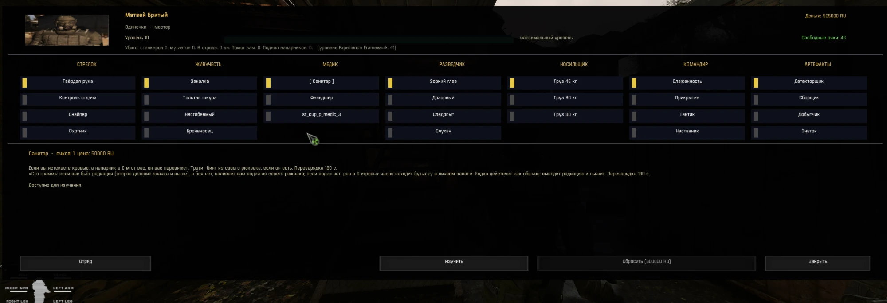 | 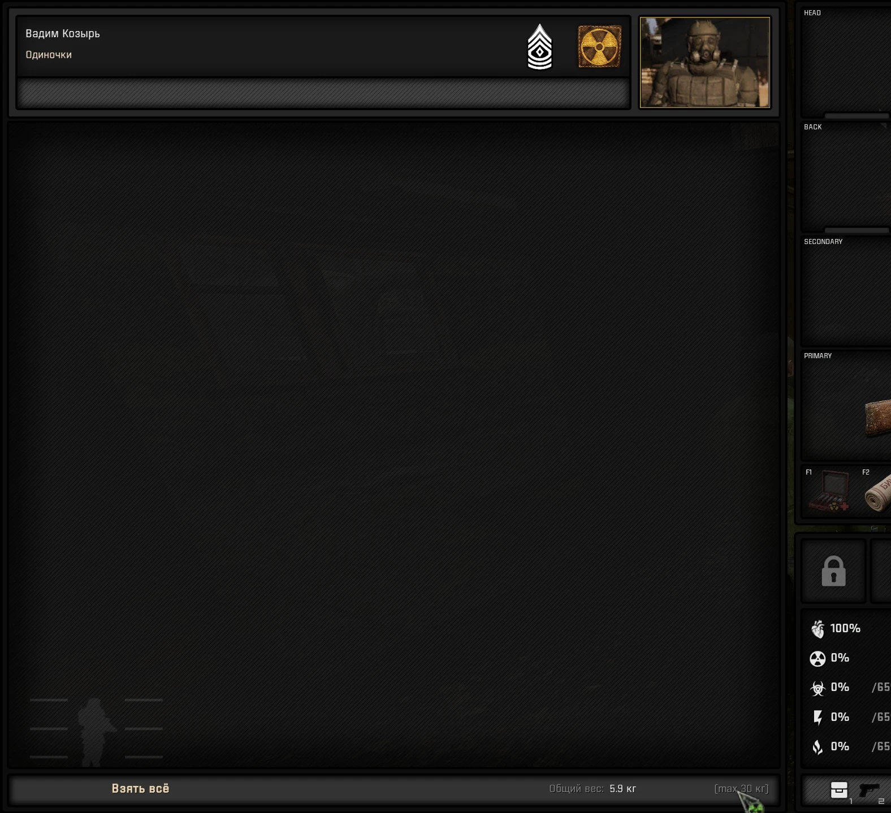 |
| <sub>Промежуточная версия v4</sub> | <sub>Исправленная надпись лимита веса</sub> |

Исправленный по ходу разработки вылет: [скриншот](docs/media/bugfix_backpack_fatal.png) — `hit.wound_2` равен `nil` в этом движке, поэтому таблицы больше не индексируются константами движка.

### MCM · «Развитие напарников»

<details>
<summary><b>Развернуть: все опции</b></summary>

<br>

| Опция | По умолчанию | Что делает |
|---|:-:|---|
| Включить мод | вкл | Если выключить, опыт не начисляется и перки не действуют. Прогресс в сохранении остаётся |
| Множитель опыта | 1 (0,25–4) | Умножает весь опыт напарников |
| Множитель цен | 1 (0–3) | Цены перков и сброса; 0 — бесплатно |
| Сила перков | 1 (0,5–1,5) | Насколько сильно действуют числовые эффекты перков |
| Ветка «Стрелок» / «Живучесть» / «Медик» / «Разведчик» / «Носильщик» / «Командир» / «Артефакты» | вкл | Выключенная ветка не действует и недоступна для изучения |
| Личный запас медика | вкл | Медик может перевязать без бинта и раз в несколько часов достать аптечку, антирад или водку из запаса |
| Медик поит водкой от радиации | вкл | Если выключить, радиацию лечит только антирадом (со второй ступени) |
| Спаивать сталкера | выкл | Напарники регулярно поят вас водкой, даже без радиации |
| Спаивать: интервал | 60 (15–120) игровых минут | Как часто наливают |
| Фразы напарников | вкл | Комментарии к происходящему |
| Частота фраз | обычно | выключено / редко / обычно / часто |
| Анекдоты | вкл | Анекдоты в спокойной обстановке и реплика в диалоге |
| Озвучка фраз | вкл | Проигрывать .ogg от напарника |
| Игрока можно вывести из строя | вкл | Нокдаун с подъёмом «Реаниматологом»; выкл — умираете как обычно |
| Сообщения искателя артефактов | вкл | Сообщения о найденных и добытых артефактах; метки остаются |
| Сообщение о новом уровне | вкл | Сообщение, когда напарник получает уровень |
| Сообщения разведчика | вкл | Опасные мутанты и группы врагов; метки остаются |
| Кнопка в панели Useful Idiots | вкл | Вступает в силу после перезапуска игры |
| Связь с Companion DBNO | вкл | Нужна «Несгибаемому» и подъёму напарников; вступает в силу после загрузки сохранения |
| Клавиша окна подготовки | не назначена | Окно напарника под прицелом или список отряда |
| Отладка в лог | выкл | Строки `[CUP][dbg]`: опыт, разброс, действия медика |

</details>

### Совместимость

| Мод | Как сочетается |
|---|---|
| **Useful Idiots** | Кнопка окна подготовки в заголовке панели |
| **Companion Downed But Not Out** | Мост: «Несгибаемый» и подъём упавших напарников «Реаниматологом» |
| **Body Health System** | Аптечка медика лечит и части тела |
| **Experience Framework** | Уровень EF виден в статистике напарника |
| **Soulslike** | Обычная смерть идёт штатным путём — мод работает как раньше |
| **Tougher NPCs** | Уже снижает урон по напарникам; множители перемножаются |
| **FDDA** | Анимация при лечении медиком не запускается |
| **Наём через диалог G_FLAT** | Прогресс переносится на нового напарника |

Чужие файлы мод не перезаписывает. Новых предметов, секций и инфопоршней нет — в сохранение пишутся только таблицы мода.

<p align="right"><a href="#top">▲ наверх</a></p>

---

<a id="backpack"></a>

<p align="center">
  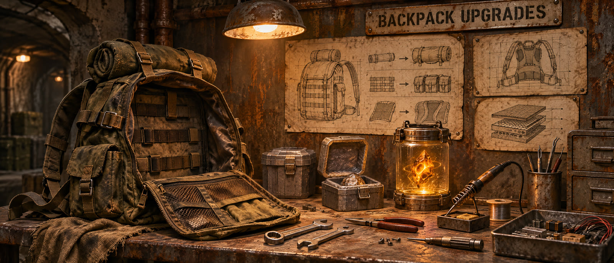
</p>

## ☢ АПГРЕЙДЫ РЮКЗАКОВ

<p>
  
  
  
  
</p>

> 📟 **КПК** · *техник* · «Рюкзак — не мешок. Принеси набор, сделаю из него вещь.»

Рюкзаки получают дерево улучшений у техников и на верстаке. На развилках выбирается одно улучшение из двух. Действуют улучшения **надетого** рюкзака.

### Классы рюкзаков

| Класс | Секции предметов | Базовая прибавка веса | Наборы для столбцов 1 / 2 / 3 |
|---|---|:-:|:-:|
| Лёгкий | `itm_backpack` | 21 кг | 1 / 1 / 2 |
| Средний | `equ_small_pack`, `equ_small_military_pack` | 28 кг, 34 кг | 1 / 2 / 2 |
| Тяжёлый | `equ_military_pack` | 41 кг | 1 / 2 / 3 |
| Элитный | `equ_tourist_pack` | 47 кг | 2 / 3 / 3 |

<sub>«Наборы» — уровень набора для улучшений, который нужен на верстаке.</sub>

<details>
<summary><b>Развернуть: все улучшения по веткам</b></summary>

<br>

**ОБЪЁМ**

| Улучшение | Эффект | Исключает |
|---|---|---|
| Дополнительные карманы | Немного увеличивают переносимый вес | — |
| Расширенный объём | Заметно увеличивает переносимый вес | Облегчённый каркас |
| Облегчённый каркас | Чуть меньше прибавка к весу, зато ниже расход выносливости при движении | Расширенный объём |
| Грузовая рама | Максимальная прибавка к переносимому весу | Компрессионные стяжки |
| Компрессионные стяжки | Небольшая прибавка к весу и ускоренное восстановление выносливости | Грузовая рама |

**ЗАЩИТА**

| Улучшение | Эффект | Исключает |
|---|---|---|
| Защитная пропитка | Слегка ослабляет радиационные и химические поражения | — |
| Свинцовая подкладка | Снижает радиационное облучение | Химзащитный чехол |
| Химзащитный чехол | Снижает урон от химических ожогов | Свинцовая подкладка |
| Термоизоляция | Снижает урон от огня и жара | Диэлектрическая прокладка |
| Диэлектрическая прокладка | Снижает урон от электричества | Термоизоляция |

**ЭРГОНОМИКА**

| Улучшение | Эффект | Исключает |
|---|---|---|
| Анатомические лямки | Снижают расход выносливости при движении | — |
| Поясной ремень | Ускоряет восстановление выносливости | Кевларовая вставка |
| Кевларовая вставка | Снижает урон от пуль, осколков и когтей при попаданиях в спину | Поясной ремень |
| Система распределения веса | Существенно снижает расход выносливости | — |

**ПОДВЕСКА**

| Улучшение | Эффект | Исключает |
|---|---|---|
| Подсумки на лямках | Ускоряют снаряжение и разряжание магазинов | — |
| Быстрые карманы | Ускоряют перезарядку оружия и снаряжение магазинов | Облегчённая подвеска |
| Облегчённая подвеска | Повышает скорость спринта и бега | Быстрые карманы |
| Усиленные лямки | Увеличивают высоту прыжка | Подсумки быстрого доступа |
| Подсумки быстрого доступа | Ещё быстрее снаряжение магазинов и немного больше переносимый вес | Усиленные лямки |

**ОТСЕК**

| Улучшение | Эффект | Исключает |
|---|---|---|
| Контейнерный отсек | **+1 ячейка для артефакта** (нужен надетый костюм, всего не больше 5 ячеек). Заодно немного снижает радиационное облучение | — |
| Свинцовый отсек | Дополнительно снижает радиационное облучение | Пси-экран |
| Пси-экран | Снижает пси-воздействие | Свинцовый отсек |
| Экранированный модуль | Немного снижает радиационное облучение и пси-воздействие | — |

<sub>Названия веток здесь условные — в игре это пять столбцов дерева улучшений.</sub>

</details>

### MCM · «Улучшения рюкзаков»

| Опция | По умолчанию | Что делает |
|---|:-:|---|
| Сила эффектов | 1 (0,5–1,5) | Общий множитель всех скриптовых эффектов |
| Защита от урона | вкл | Радиация, химия, огонь, электричество, пси и кевларовая вставка |
| Эффекты выносливости | вкл | Снижение расхода и ускоренное восстановление |
| Скорость и прыжок | вкл | Бонусы к спринту, бегу и высоте прыжка |
| Перезарядка и магазины | вкл | Ускорение перезарядки и снаряжения магазинов (Mags Redux) |
| Доп. ячейка артефакта | вкл | +1 ячейка на поясе от «Контейнерного отсека» |
| Отладка в лог | выкл | Суммарные эффекты при смене рюкзака или улучшений |

Вес рюкзака (кг) задаётся конфигами и в MCM не меняется. Суммарное снижение любого урона ограничено 50%.

<p align="right"><a href="#top">▲ наверх</a></p>

---

<a id="zombie"></a>

<p align="center">
  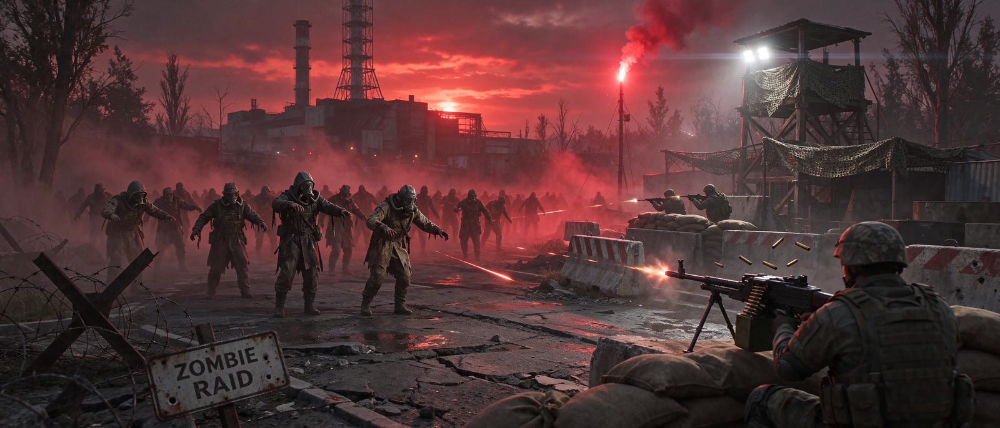
</p>

## ☢ РЕЙД ЗОМБИРОВАННЫХ

<p>
  
  
  
</p>

> 📟 **КПК** · *общий канал* · «ВНИМАНИЕ! Орда зомбированных на подходе.»

Орда появляется по клавише (по умолчанию **F10**) или сама, случайно. Вместе с ней выдаётся задание **«Отбить атаку зомбированных»** со счётчиком оставшихся.

| Размер | Численность | Состав |
|---|:-:|---|
| 1 — Лёгкий | ~10 | Новички и опытные |
| 2 — Средний | ~20 | До экспертов |
| 3 — Большой *(по умолчанию)* | ~50 | До мастеров |
| 4 — Огромный | ~90 | Много мастеров |

**Награда считается по убитым:**

- за каждого зомбированного платят по его рангу; за убитых вами — полностью, за убитых напарниками — половину;
- чем большую долю орды выбила ваша группа, тем больше денег, тайников (до трёх) и репутации у своей группировки;
- рейд, не отбитый за 24 игровых часа, закрывается: половина оплаты за убитых, без тайников.

### MCM · «Рейд зомбированных (Mixon)»

| Опция | По умолчанию | Диапазон |
|---|:-:|---|
| Размер рейда | 3 — Большой | 1–4 |
| Расстояние появления | 75 м | 30–250 м |
| Цель атаки | Ближайший лагерь (база) | Лагерь / Игрок |
| Клавиша вызова рейда | F10 | — |
| Случайные рейды | вкл | — |
| Шанс рейда за игровой час | 3% | 1–30% |
| Не чаще чем раз в N игровых часов | 24 | 6–168 |
| Максимальный размер случайного рейда | 4 — Огромный | 1–4 |

Случайные рейды не начинаются в подземельях и лабораториях, во время выброса и пси-шторма, пока вы спите и пока не закрыт предыдущий рейд. Маленькие орды выпадают чаще больших.

<p align="right"><a href="#top">▲ наверх</a></p>

---

<a id="carry"></a>

<p align="center">
  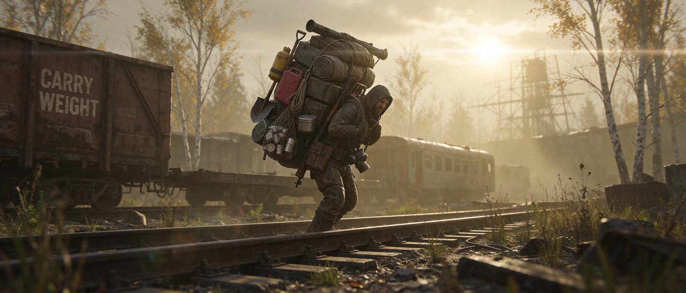
</p>

## ☢ ПЕРЕНОСИМЫЙ ВЕС

> 📟 **КПК** · *заметка* · «Хабар лишним не бывает. Бывает мало спины.»

Самый простой мод набора: один ползунок.

| Опция MCM | По умолчанию | Диапазон |
|---|:-:|---|
| Доп. переносимый вес, кг | 50 | 10–150, шаг 10 |

Применяется сразу, без перезагрузки. Прибавка идёт через весовой API Experience Framework (`weight.add_weight`).

<p align="right"><a href="#top">▲ наверх</a></p>

---

<a id="install"></a>

## ☢ УСТАНОВКА (MO2)

  


### Зависимости

| Мод | Обязательно | Необязательно (подхватывается само, всё есть в GAMMA) |
|---|---|---|
| **Mixon Companion Training** | Anomaly 1.5.3 + Modded Exes (2024+), MCM | Useful Idiots (кнопка подготовки), Companion DBNO (Реаниматолог поднимает упавших напарников), Body Health System (лечение частей тела), Experience Framework (уровень напарника в окне), Soulslike, G_FLAT, Tougher Important NPCs |
| **Mixon Backpack Upgrades** | Anomaly 1.5.3 + Modded Exes (2024+, нужен для доп. ячейки артефакта), MCM | Experience Framework (бонусы к бегу, прыжку и весу), a_pack Upgradeable Backpacks (патч совместимости встроен) |
| **Zombie Raid (Mixon)** | Anomaly 1.5.3, MCM | тяжёлые зомби-отряды GAMMA (используются в больших рейдах, если есть) |
| **Carry Weight (Mixon)** | Experience Framework, MCM | — |

Все обязательные зависимости входят в G.A.M.M.A. — на GAMMA ничего ставить дополнительно не нужно.

1. Скачайте репозиторий (**Code → Download ZIP**) и распакуйте.
2. Для каждого нужного мода из папки [`mods/`](mods) скопируйте папку целиком в `<GAMMA>\mods\`, например `E:\GAMMA\GAMMA RC3\mods\Mixon Companion Training\` (внутри должна быть папка `gamedata`).
3. Откройте MO2, нажмите **F5** (обновить) и **включите** моды галочкой. Ставьте их **выше** (с большим приоритетом) остальных модов — проще всего перетащить в самый верх списка.
4. Запустите игру. Настройки — в MCM: «Развитие напарников», «Улучшения рюкзаков», «Рейд зомбированных (Mixon)», «Переносимый вес (Mixon)».

```text
<GAMMA>\mods\
├── Mixon Companion Training\
│   ├── gamedata\
│   └── meta.ini
├── Mixon Backpack Upgrades\
├── Zombie Raid (Mixon)\
└── Carry Weight (Mixon)\
```

> 📟 **КПК** · *важно* · После обновления xml или текстур игру нужно перезапускать **полностью** (выход в Windows): при загрузке сохранения перезагружаются только скрипты.

<p align="right"><a href="#top">▲ наверх</a></p>

---

<a id="update"></a>

## ☢ КАК ОБНОВИТЬ

1. Закройте игру полностью.
2. Скачайте свежую версию репозитория (**Code → Download ZIP**; если клонировали — `git pull`).
3. Замените папки модов в `<GAMMA>\mods\` новыми. Порядок и галочки в MO2 сохранятся.
4. Запустите игру заново и загрузите сохранение.

Записи напарников из старых версий Companion Training пересчитываются сами при первой загрузке (в логе — строки `[CUP] migration ...`). Если купленные перки не помещаются в новые цены в очках, все перки сбрасываются и очки возвращаются; деньги не возвращаются.

<p align="right"><a href="#top">▲ наверх</a></p>

---

<a id="fixes"></a>

<p align="center">
  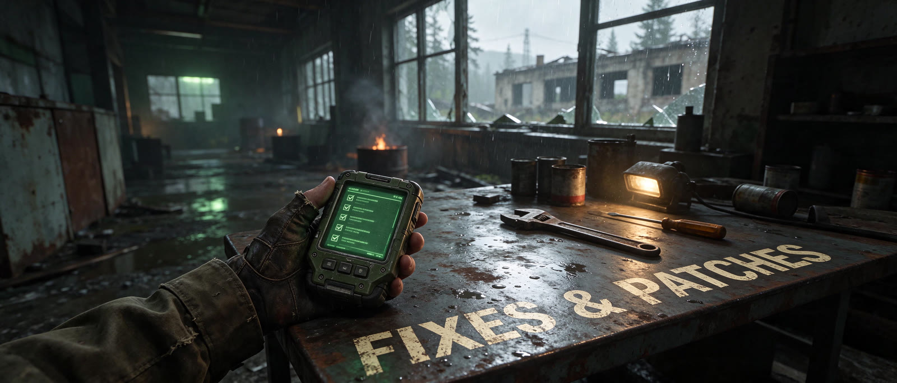
</p>

## ☢ ИСПРАВЛЕНИЯ К ЧУЖИМ МОДАМ

> 📟 **КПК** · *техник* · «Чужое не переписывал. Чинил только там, где падало.»

Патчи лежат в [`patches/`](patches) в формате `diff`. Применять из папки `mods` вашей сборки:

```bash
cd "E:/GAMMA/GAMMA RC3/mods"
git apply -p1 C:/path/to/patches/tlra_valid_vertex_id_fix.diff
```

Если папка мода у вас называется иначе (например, Dirt & Wear), поправьте путь в первых строках diff или замените строки вручную: в diff видно, что именно поменять. **Перед применением сделайте копию файла.**

<details open>
<summary><b>Таблица исправлений</b></summary>

<br>

| Мод | Ошибка | Исправление |
|---|---|---|
| **The Long Road Ahead 2.3.1** | Вылет `zzzz_the_long_road_ahead.script:3562: attempt to call field 'valid_vertex_id' (a nil value)` при телепорте напарников | [`tlra_valid_vertex_id_fix.diff`](patches/tlra_valid_vertex_id_fix.diff): проверка вызывается, только если функция есть в движке |
| **Dirt & Wear** | Ошибки таймера и восстановления, конфликт шейдеров с SSS23/Atmospherics | [`dirt_wear_fix.diff`](patches/dirt_wear_fix.diff), [`dirt_shake_weapon_fix.diff`](patches/dirt_shake_weapon_fix.diff) (скрипты). Шейдеры нужно объединить с версиями SSS23/Atmospherics вручную |
| **Companion anti awol 1.1.2** | Битые/непереведённые строки в русской локализации | [`companion_anti_awol_rus_fix.diff`](patches/companion_anti_awol_rus_fix.diff) (файл в cp1251) |
| **LootBoxes GAMMA** | Опечатка `arcade_token` вместо `arcade_tokens` в настройках инструментов | Исправить имя секции в `configs/items/settings/lootbox_tools.ltx` |
| **trader_autoinject** (старые копии) | Конфликт двух версий `trader_autoinject.script` | Оставить одну, самую новую копию; старые отключить в MO2 |
| **Anomalous Creation** | Двойной спавн и вылет на `nil` physics shell | Проверка `get_physics_shell()` на `nil` и защита от повторного спавна |
| **MCP Bridge (stalker-mcp)** | Под MSIX-версией Claude Desktop папка моста виртуализируется, мост не видит файлы | Путь моста перенесён в `$app_data_root$\mcp_bridge\` (лицензия мода CC BY-NC-ND — патч не публикуется, только описание) |

</details>

> 📟 **КПК** · *наблюдение* · «Набор отмычек» из LootBoxes — **пассивный** предмет, его не открывают. Он облегчает вскрытие ящиков, а тратятся отдельные отмычки.

<p align="right"><a href="#top">▲ наверх</a></p>

---

<a id="faq"></a>

## ☢ FAQ

<details>
<summary><b>Поменял файлы мода, а в игре ничего не изменилось</b></summary>

<br>

При загрузке сохранения перезагружаются только скрипты. После обновления xml или текстур нужен полный перезапуск игры — с выходом в Windows.

</details>

<details>
<summary><b>Нужна ли новая игра?</b></summary>

<br>

Нет. Моды ставятся на существующие сохранения; записи для текущих напарников создаются сами.

</details>

<details>
<summary><b>Меня убили, а нокдауна не было</b></summary>

<br>

Нокдаун срабатывает, только если рядом есть напарник с перком «Реаниматолог»: он жив, на ногах и не дальше 50 м. Без него смерть обычная. Не срабатывает также на арене, при гибели от выброса или пси-шторма, во время перезарядки и если опция «Игрока можно вывести из строя» выключена в MCM.

</details>

<details>
<summary><b>Как часто напарник может меня поднять?</b></summary>

<br>

Раз в 4 игровых часа. Перезарядка пишется в сохранение, оставшееся время видно в описании перка. Упадёте за это время ещё раз — умрёте.

</details>

<details>
<summary><b>Напарник застрял и не может до меня дойти</b></summary>

<br>

Сработает страховка: он телепортируется на проверенную клетку AI-карты рядом с вами, а таймер получит +15 с. Если подходящей клетки нет, телепорта не будет.

</details>

<details>
<summary><b>Как открыть «Набор отмычек»?</b></summary>

<br>

Никак — это пассивный предмет из LootBoxes. Он облегчает вскрытие ящиков; тратятся отдельные отмычки.

</details>

<details>
<summary><b>Очков не хватает на все ветки</b></summary>

<br>

Так задумано: на 10 уровне у напарника 12 очков, всё дерево стоит 46. Перки можно сбросить (80 000 RU × уровень) и распределить заново, а цены — изменить множителем в MCM.

</details>

<details>
<summary><b>Напарник не ищет артефакты</b></summary>

<br>

Положите ему в рюкзак детектор: Отклик, Медведь, Гризли, Велес или Сварог. От детектора зависит радиус поиска.

</details>

<details>
<summary><b>Перк «Несгибаемый» недоступен</b></summary>

<br>

Ему нужен мод Companion Downed But Not Out и включённая опция «Связь с Companion DBNO» в MCM.

</details>

<details>
<summary><b>Как удалить Companion Training?</b></summary>

<br>

Закройте окно подготовки, сохранитесь, выключите мод в MO2. Сохранение загрузится, данные мода просто перестанут читаться. Перед удалением заберите у носильщиков лишний груз — лимит вернётся к 30 кг. Не сохраняйтесь лёжа в нокдауне: иначе приказы «ждать» и «игнорировать бой» у напарника придётся выставить заново вручную.

</details>

<p align="right"><a href="#top">▲ наверх</a></p>

---

<a id="changelog"></a>

## ☢ CHANGELOG

Вехи **Mixon Companion Training**. Подробности — в [`README_RU.txt`](mods/Mixon%20Companion%20Training/README_RU.txt).

| Версия | Что появилось |
|:-:|---|
| **v9** | Никто не проваливается под землю: телепорт Реаниматолога только на проверенную клетку AI-карты в 1,2–1,8 м от игрока. В пути напарник не реагирует на опасность. Камера лёжа не уходит под землю и в склон |
| **v8** | Подъём вплотную: с 5 м напарник идёт вприсядку, рядом присаживается и остаётся так до конца. Зелёная полоса «Напарник оказывает помощь» |
| **v7** | Реаниматолог гарантированно доходит: приказ «идти в точку» каждый тик, врагов не видит, телепорт-страховка, +15 с к таймеру |
| **v6** | Падение на спину: камера смотрит в небо, дыхание, покачивание, моргание; плавный подъём |
| **v5** | Цены ×2 (50 000 / 120 000 / 240 000 RU). «Реаниматолог» — отдельный перк за 4 очка и 320 000 RU, ступень 3 Медика — «Полевой хирург». Окно перерисовано в стиле КПК |
| **v4** | Фразы напарников и анекдоты: 160 реплик, 42 анекдота, поддержка озвучки. Опция «Спаивать сталкера» |
| **v3** | Медик и радиация: водка («Сто грамм») и антирад |
| **v2** | Цены ×10, ступени стоят 1 / 2 / 3 очка. Медик сам применяет аптечку. Нокдаун игрока. Ветка «Артефакты» |
| **v1** | Основа: опыт, 10 уровней, шесть веток перков, окно подготовки, кнопка в Useful Idiots, мост с Companion DBNO, MCM |

<p align="right"><a href="#top">▲ наверх</a></p>

---

<a id="license"></a>

## ☢ ЛИЦЕНЗИЯ

- **Код и тексты модов Mixon** — свободно для некоммерческого использования в сборках S.T.A.L.K.E.R.
- **Озвучка** сгенерирована через ElevenLabs.
- **Чужие моды** принадлежат их авторам; здесь только патчи и описания.

---

<p align="center">
  <sub>Удачной охоты, сталкер.</sub><br>
  <sub>MIXON · ЗОНА · GAMMA RC3</sub>
</p>
