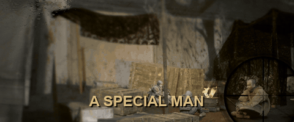
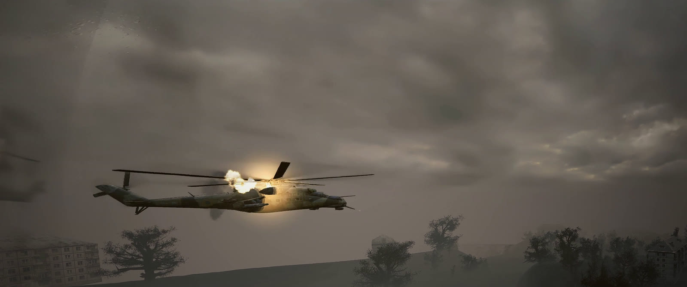
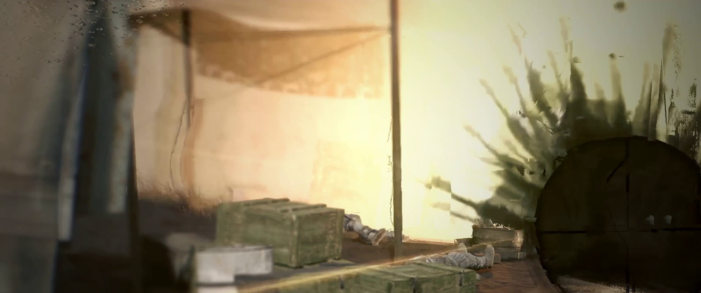
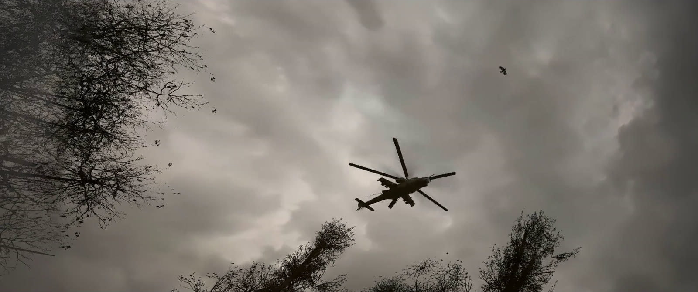
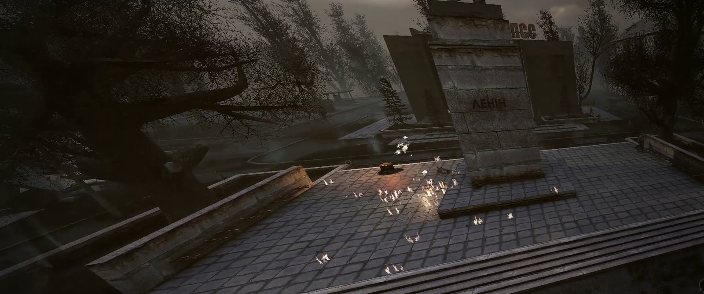
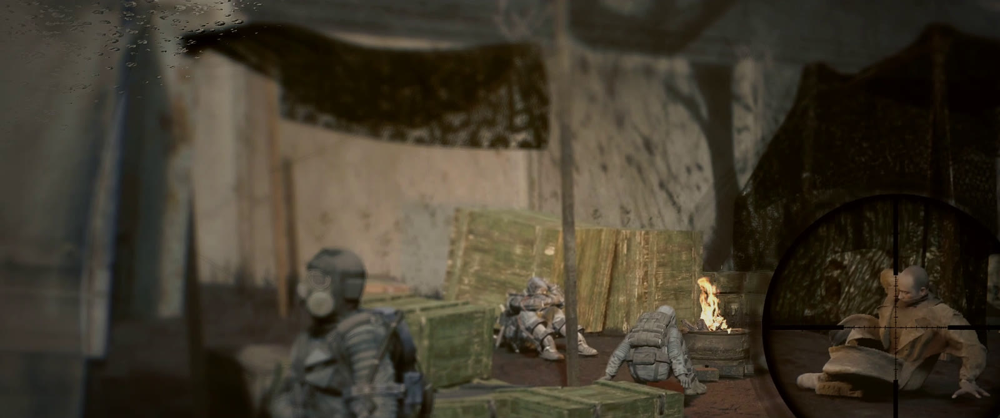
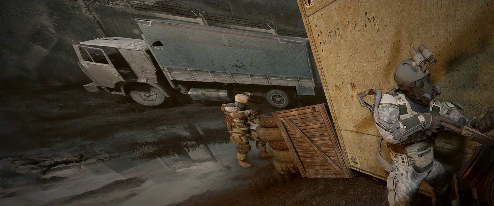
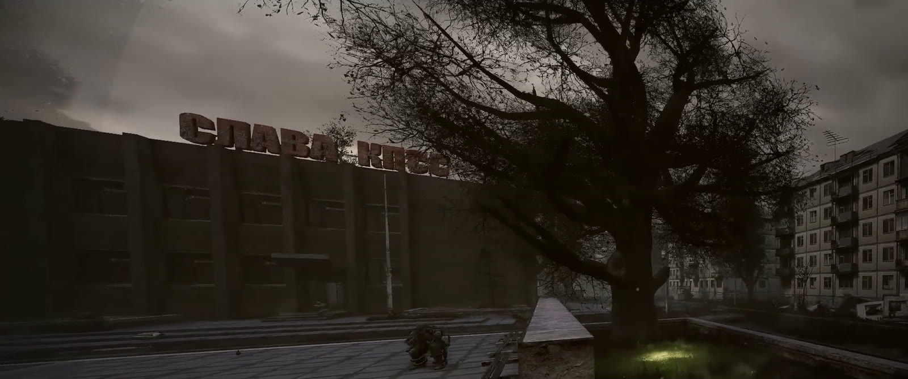

<p align="center">
  
</p>

<h2 align="center">💀 THE MERCENARY UPDATE</h2>

<p align="center">
  
  
  
  
  <a href="https://www.moddb.com/mods/stalker-anomaly/addons/zone-operations-mixon"></a>
</p>

> 📟 **PDA** · *Dushman, Dead City* · "Snake! Snake, answer me!.. Hold on, boys! I'm sending my best — they're on their way!"

The mercs of the Dead City get a war of their own, and a story that keeps going: three operations in a row, a gunship, snipers on the roofs, minefields, a radio voiced in English and Russian — and a Sin messenger who brought the outpost the wrong kind of news.

## 🎬 Watch

| | |
|:-:|:-:|
| [](https://github.com/MixonUP/mixon-gamma-mods/blob/main/docs/media/zop/mercs/mercs_trailer.mp4) | [](https://github.com/MixonUP/mixon-gamma-mods/blob/main/docs/media/zop/mercs/a_special_man.mp4) |
| ▶ **[Mercenary trailer](https://github.com/MixonUP/mixon-gamma-mods/blob/main/docs/media/zop/mercs/mercs_trailer.mp4)** · 54 s | ▶ **[A Special Man](https://github.com/MixonUP/mixon-gamma-mods/blob/main/docs/media/zop/mercs/a_special_man.mp4)** · 62 s |

Full 1080p versions are attached below: `ZOP_Mercenaries_Trailer.mp4`, `ZOP_A_Special_Man.mp4`, `ZOP_Clean_Field_ModDB_1080p.mp4`.

```
 CLEAN FIELD  ──►  A SPECIAL MAN  ──►  THE ADMINISTRATION  ──►  to be continued
 hold the HQ       story task          strike back
```

## 🛡️ Clean Field — hold Dushman's HQ

| | |
|---|---|
|  |  |
| The Mi-24 **Falcon One** over the city | 17 merc mines at the monument |

Five minutes after you take the contract, two waves of army spetsnaz and a flanking group hit the base. The Mi-24 circles the city with rockets and suppression fire. A merc squad takes the HQ, and the roof team climbs up: the sniper **Viper** with an anti-materiel rifle and **Sledge** with an RPG, calling their hits on the radio. Reinforcements check in after a minute, then every three.

## 🕵️ A Special Man — the story task

| | |
|---|---|
|  |  |
| The Sin messenger at Snake's campfire | Sin comes in force |

A day later Dushman sends you to Snake's outpost at the Army Warehouses: an informer has promised a leak about a **very secret project** for a **very important client**. A Sin messenger comes instead. The talk at the campfire ends with a blast, and three Sin squads attack, with snipers and an RPG on the height. Dushman breaks into the radio and sends a squad of masters; the survivors walk home to the Dead City.

## ⚔️ The Administration and 🪖 the army mirror



After you report, strike back: spetsnaz inside, five mines at the door, three merc assault groups with you, a merc garrison after. Playing army? Kovalsky at Agroprom sends you against the merc HQ — now the gunship flies for you, and Viper, Sledge and the minefield are against you.

## ✨ Also in 1.3.0

- 📻 Voiced radio for the whole merc branch, **English and Russian** (MCM: voice language).
- 🌪️ No blowouts or psi storms start while an operation runs.
- 💰 Merc and army operations pay a random **20,000–40,000**.
- 🩹 **Fixed:** a native crash when anybody threw a smoke grenade with *Particles Cinematic VFX* installed. The smoke now uses its own M18 effect shipped with the mod.

## 📦 Install

Needs Anomaly 1.5.3, Modded Exes, MCM, Hideout Furniture + HF Expansion (all in G.A.M.M.A.). Extract `Mixon_Zone_Operations.zip` into `<GAMMA>/mods`, enable it in MO2. Safe for existing saves. The merc branch needs a merc character with goodwill 1000.

📖 Full branch page: **[The mercenary branch](https://github.com/MixonUP/mixon-gamma-mods/blob/main/docs/zop_mercs.en.md)** · [Русский](https://github.com/MixonUP/mixon-gamma-mods/blob/main/docs/zop_mercs.md)

<details>
<summary>🇷🇺 <b>По-русски</b></summary>

> 📟 **КПК** · *Душман, Мёртвый город* · «Змей, ответь!.. Держитесь, мужики! Высылаю лучших — уже идут к вам!»

Наёмники Мёртвого города получают свою войну и сюжет, который продолжается.

- 🛡️ **«Чистое поле»** — оборона штаба Душмана: две волны спецназа и обходная группа, Ми-24 «Сокол-1» с ракетами, на крыше снайпер Гюрза и Кувалда с РПГ против вертушки, подкрепления по рации, 17 мин у монумента.
- 🕵️ **«Особый человек»** — сюжетное задание: застава Змея на Армейских складах ждёт информатора, а приходит посланник Греха. Разговор у костра кончается взрывом, затем атака трёх отрядов Греха. Душман высылает мастеров, выжившие уходят в Мёртвый город.
- ⚔️ **«Администрация»** — ответный удар: мины у входа, спецназ внутри, три штурмовые группы наёмников, затем гарнизон.
- 🪖 **Зеркало за армию** — штурм штаба наёмников от Ковальского: вертолёт за тебя, крыша и мины против.
- 📻 Озвученная рация на русском и английском, 🌪️ во время операций нет выбросов и пси-штормов, 💰 награда 20–40 тыс.
- 🩹 Исправлен вылет при броске дымовой гранаты с Particles Cinematic VFX.

Установка: распаковать `Mixon_Zone_Operations.zip` в `<GAMMA>/mods`, включить в MO2. Подробно: **[ветка наёмников](https://github.com/MixonUP/mixon-gamma-mods/blob/main/docs/zop_mercs.md)**.

</details>
