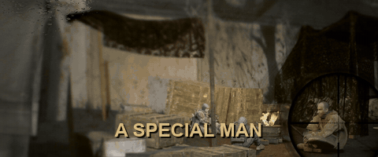
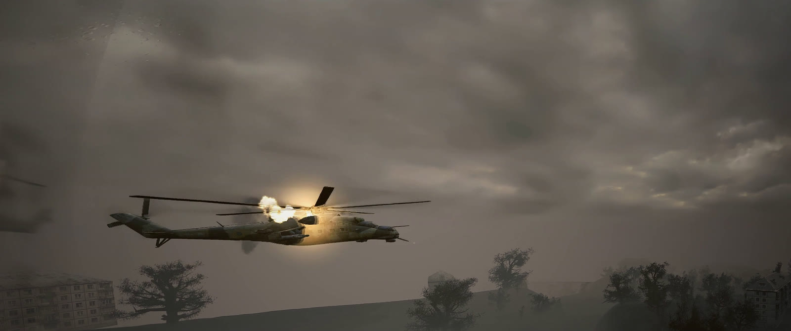
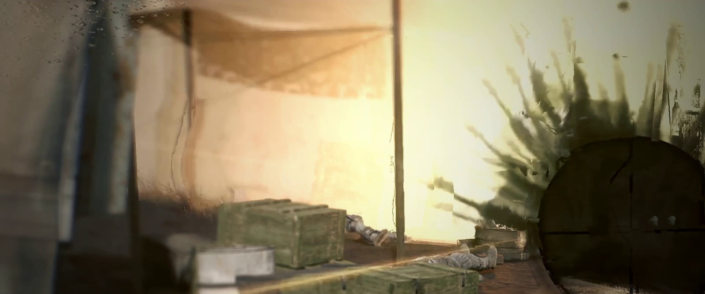
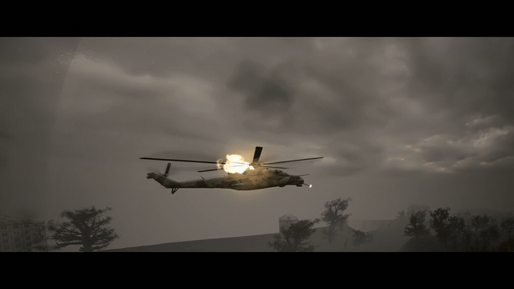
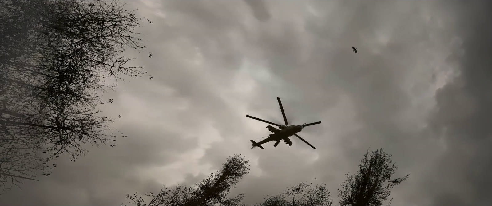
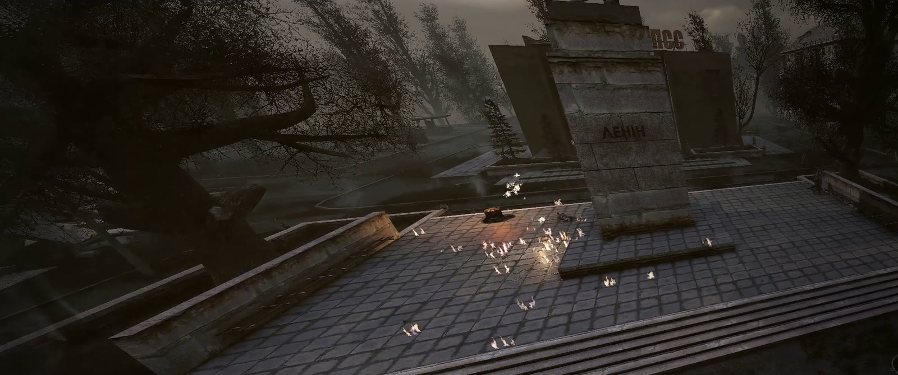
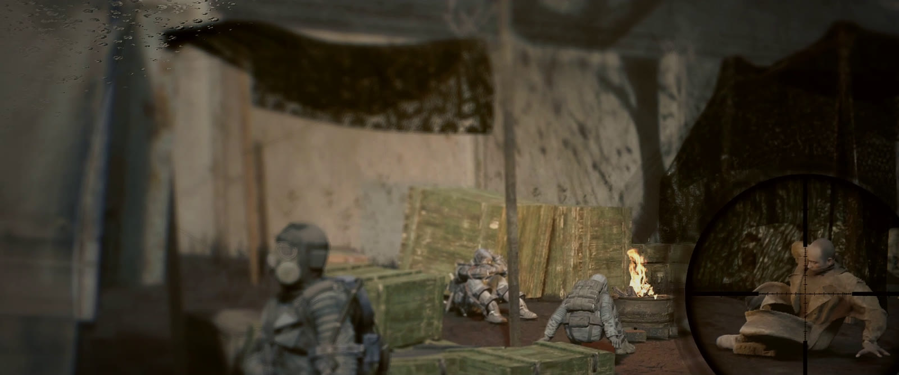
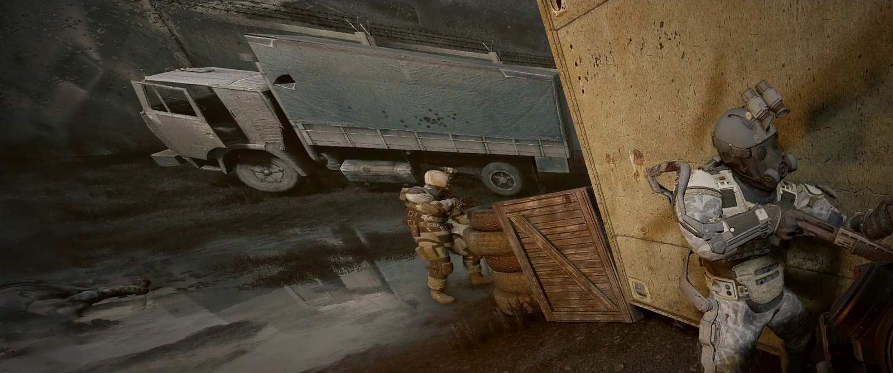
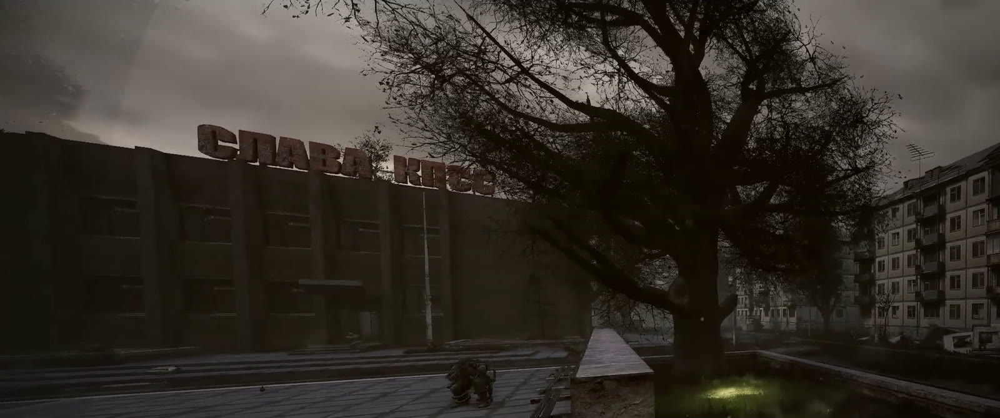

<a id="top"></a>

<p align="center">
  
</p>

<h1 align="center">💀 THE MERCENARY BRANCH · ZONE OPERATIONS</h1>

<p align="center">
  
  
  
  
  <a href="https://www.moddb.com/mods/stalker-anomaly/addons/zone-operations-mixon"></a>
</p>

<p align="center"><a href="zop_mercs.md">Русский</a> · <a href="../README.en.md">← Zone Operations</a></p>

> 📟 **PDA** · *Dushman, Dead City* · "Snake! Snake, answer me!.. Hold on, boys! I'm sending my best — they're on their way!"

The mercs of the Dead City get a war of their own, and a story that keeps going. Three operations in a row, a gunship, snipers on the roofs, minefields, a radio voiced in English and Russian — and a Sin messenger who brought the outpost the wrong kind of news.

> [!NOTE]
> The branch is out in **1.3.0** — [download on ModDB](https://www.moddb.com/mods/stalker-anomaly/addons/zone-operations-mixon).

## 🎬 Video

| | |
|---|---|
| [](media/zop/mercs/mercs_trailer.mp4) | [](media/zop/mercs/a_special_man.mp4) |
| ▶ **[Mercenary trailer](media/zop/mercs/mercs_trailer.mp4)** · 54 s | ▶ **[A Special Man](media/zop/mercs/a_special_man.mp4)** · 62 s |
| ▶ **[Clean Field, teaser](media/zop/clean_field_teaser.mp4)** · 30 s |  |

## 📖 The story

The army wants the Dead City back. Dushman's mercs have held it for years, and the spetsnaz decide it's time to clear the field. You stand with the mercs, and you hold.

A day later, Dushman has news. An informer has promised Snake's outpost at the Army Warehouses a leak about a **very secret project** for a **very important client**, and Dushman sends the man who proved himself in the fight: you. The informer who comes is not a merc. He is **Sin**.

```
 CLEAN FIELD  ──►  A SPECIAL MAN  ──►  THE ADMINISTRATION  ──►  to be continued
 hold the HQ       story task          strike back
```

You play as a mercenary; Dushman offers the first contract once the mercs trust you (goodwill 1000). Pick the radio language in MCM.

---

## 🛡️ 1. Clean Field — hold Dushman's HQ

Dushman offers the contract. Take it, and you have **five minutes** to get ready, with a minute-by-minute countdown.

| | |
|---|---|
|  |  |
| The Mi-24 "Falcon One" over the city | Sledge lands a hit on the gunship |

- **The assault.** Two waves of army spetsnaz, a legend leading every squad, come out in front of the Administration, and a separate group swings round the flank.
- **The gunship.** A Mi-24, callsign **Falcon One**, circles the city, fires rockets and lays suppression fire on you, on the lower floors of the HQ and on mercs in the open.
- **The mercs fight back.** 30 seconds in, a squad takes position **inside the HQ**. The roof team climbs up: the sniper **Viper** with an anti-materiel rifle and **Sledge** with an RPG. Their job is the helicopter, and they call their hits on the radio. The first reinforcement checks in after a minute, then one every three.
- **The minefield.** The square round the monument is mined: 17 mines that go off under the spetsnaz, not under you.
- **Win or lose.** Break both waves and the base is yours. Downing the gunship is up to you; if it survives, it flies off. If no merc fighter is left near the HQ, or you leave the base for too long, the operation fails, and Dushman offers it again in three days.



---

## 🕵️ 2. A Special Man — the story task

A day after Clean Field, Dushman calls you on the radio: go to the merc outpost at the **Army Warehouses**, see the commander and find out what's going on.

| | |
|---|---|
|  |  |
| The Sin messenger at the campfire with Snake and his men | The conversation is over |

- **The outpost.** The commander is **Snake**: bald, in an exoskeleton, his men round the campfire. They're waiting for the informer.
- **The guest.** A minute after you reach the gate, he walks in: a **Sin messenger**, neutral for now. He walks up to Snake and preaches, in a voice you won't forget. No names, no price. Then he ends the conversation the way Sin does. The blast takes Snake and everyone near the fire. If you stood too close, it takes you too.
- **The attack.** Sin comes in force: three squads, preaching over the radio. Two storm the outpost; the third holds the height above it with three snipers, three assault men and a grenadier with an RPG. Fifteen seconds in, Dushman breaks into the radio, shouting for Snake, and sends his best, a squad of masters.
- **After.** Hold the outpost, and the survivors walk home to the Dead City. Report to Dushman. He tells you a little: yes, there is a project, and yes, the client is very important. You'll learn the rest in time.



---

## ⚔️ 3. The Administration — strike back

Once you report, Dushman gives the order. The spetsnaz hold the Administration: squads dug in inside, and **five mines** at the entrance. These go off under you too — watch your step. Three merc assault groups go in with you. Take the building and a merc garrison moves in.



### 🪖 The mirror: playing army

Playing army? Colonel Kovalsky at Agroprom (goodwill 1000) sends three spetsnaz squads against the merc HQ, held by five merc squads with two more on the way. Now the gunship flies **for you**, and Viper, Sledge and the minefield are against you. Dushman and his people pull back, and return if the assault fails.

---

## 🧭 At a glance

| | Clean Field | A Special Man | The Administration | Mirror (army) |
|---|---|---|---|---|
| **Given by** | Dushman | Dushman, on the radio | Dushman | Kovalsky |
| **Needs** | merc, goodwill 1000 | a day after Clean Field | reporting to Dushman | army, goodwill 1000 |
| **Where** | Dead City | Army Warehouses | Dead City | Dead City |
| **Enemy** | spetsnaz + Mi-24 | Sin, 3 squads | spetsnaz, mines | mercs, roof team, mines |
| **Pay** | 20–40k + goodwill | 20–40k + 200 goodwill | 20–40k + goodwill | 20–40k + goodwill |

- 📻 Every radio line is voiced in **English and Russian**.
- 🌪️ While an operation runs, **no blowouts or psi storms** start.
- 💰 Pay is random, rounded to thousands; the multiplier is in MCM.

---

## 🔮 What's next

"A Special Man" opens a story, it doesn't close one. Planned:

- **The secret project** — who Dushman's client is, what Sin knew, and why they paid with one of their own to keep it quiet.
- **Sin's answer** — the faction doesn't forget an outpost it burned.
- **More merc contracts** across the Zone, with the same voiced radio, air support and set-piece battles.

Ideas for what the mercs should do next? Post them in [Issues](https://github.com/MixonUP/mixon-gamma-mods/issues) or on [ModDB](https://www.moddb.com/mods/stalker-anomaly/addons/zone-operations-mixon).

<p align="center"><a href="#top">▲ top</a> · <a href="../README.en.md">← Zone Operations</a></p>
