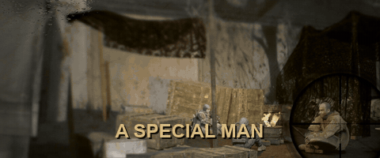
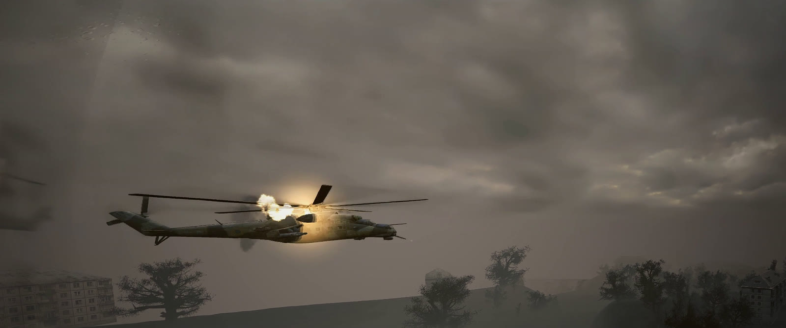
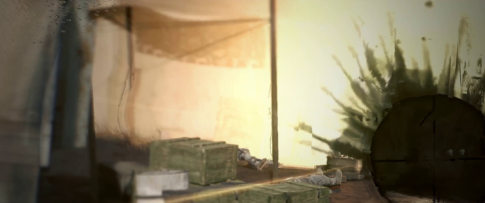
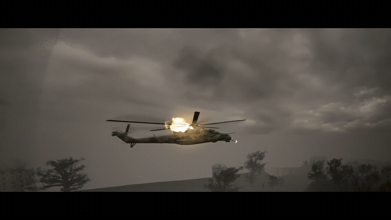
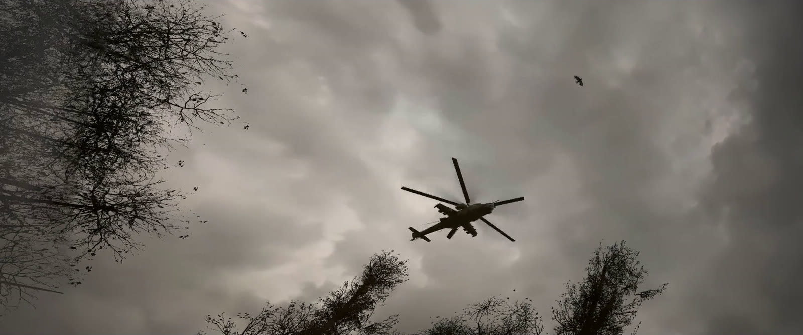
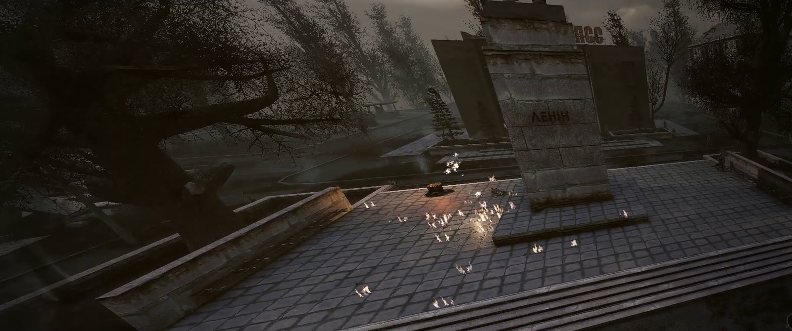
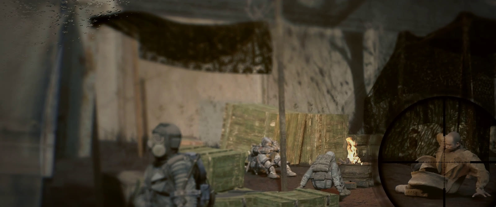
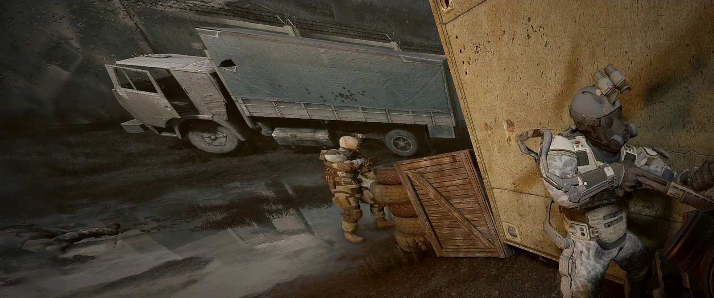
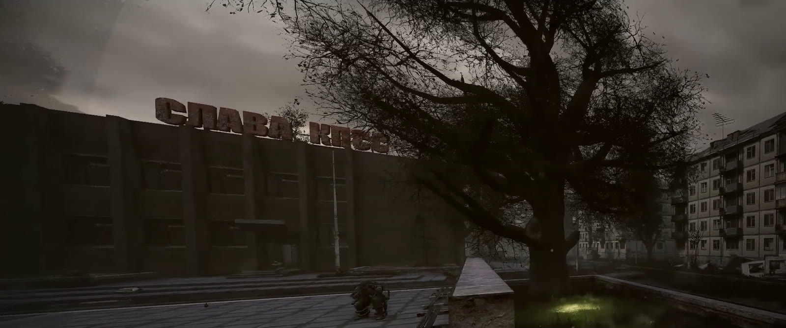

<a id="top"></a>

<p align="center">
  
</p>

<h1 align="center">💀 ВЕТКА НАЁМНИКОВ · ZONE OPERATIONS</h1>

<p align="center">
  
  
  
  
  <a href="https://www.moddb.com/mods/stalker-anomaly/addons/zone-operations-mixon"></a>
</p>

<p align="center"><a href="zop_mercs.en.md">English</a> · <a href="../README.md#zop">← Операции Зоны</a></p>

> 📟 **КПК** · *Душман, Мёртвый город* · «Змей, ответь!.. Держитесь, мужики! Высылаю лучших — уже идут к вам!»

Наёмники Мёртвого города получают свою войну и сюжет, который продолжается. Три операции подряд, вертолёт, снайперы на крышах, минные поля, озвученная рация на русском и английском — и посланник Греха, который принёс на заставу не те новости.

> [!NOTE]
> Ветка в разработке и войдёт в следующее обновление. В версии 1.2.0 на ModDB её ещё нет.

## 🎬 Видео

| | |
|---|---|
| [](media/zop/mercs/mercs_trailer.mp4) | [](media/zop/mercs/a_special_man.mp4) |
| ▶ **[Трейлер наёмников](media/zop/mercs/mercs_trailer.mp4)** · 54 с | ▶ **[«Особый человек»](media/zop/mercs/a_special_man.mp4)** · 62 с |
| ▶ **[«Чистое поле», тизер](media/zop/clean_field_teaser.mp4)** · 30 с |  |

## 📖 Сюжет

Армия хочет вернуть Мёртвый город. Наёмники Душмана держат его годами, и спецназ решает, что пора зачистить поле. Ты стоишь с наёмниками — и держишь.

Через день у Душмана новости. Информатор пообещал заставе Змея на Армейских складах слив про **очень секретный проект** для **очень важного заказчика**, и Душман отправляет туда того, кто показал себя в бою, — тебя. Только информатор, который приходит, — не наёмник. Он из **Греха**.

```
 ЧИСТОЕ ПОЛЕ  ──►  ОСОБЫЙ ЧЕЛОВЕК  ──►  АДМИНИСТРАЦИЯ  ──►  продолжение следует
 оборона штаба     сюжетное задание     ответный удар
```

Играешь за наёмников; первый контракт Душман даёт, когда наёмники тебе доверяют (репутация 1000). Язык рации — в MCM.

---

## 🛡️ 1. Чистое поле — удержать штаб Душмана

Душман предлагает контракт. Взял — у тебя **пять минут** на подготовку, отсчёт идёт поминутно.

| | |
|---|---|
|  |  |
| Ми-24 «Сокол-1» над городом | Кувалда попадает по вертушке |

- **Штурм.** Две волны армейского спецназа, в каждом отряде легенда, выходят перед Администрацией. Отдельная группа заходит во фланг.
- **Вертолёт.** Ми-24, позывной **«Сокол-1»**, кружит над городом, пускает ракеты и давит огнём — по тебе, по нижним этажам штаба, по наёмникам на открытом месте.
- **Наёмники отвечают.** На 30-й секунде отряд занимает позиции **внутри штаба**. На крышу поднимаются снайпер **Гюрза** со «слонобойкой» и **Кувалда** с РПГ — их дело вертолёт, о попаданиях они докладывают по рации. Первое подкрепление через минуту, дальше каждые три.
- **Минное поле.** Площадь у монумента заминирована: 17 мин, которые рвутся под спецназом, а не под тобой.
- **Победа и поражение.** Выбей обе волны — база твоя. Сбить вертолёт можно, но не обязательно: уцелевший улетит. Если у штаба не осталось ни одного бойца наёмников или ты надолго ушёл с базы — провал, и Душман предложит контракт снова через три дня.



---

## 🕵️ 2. Особый человек — сюжетное задание

Через день после «Чистого поля» Душман выходит на связь: иди на заставу наёмников на **Армейских складах**, найди командира, узнай, что там происходит.

| | |
|---|---|
|  |  |
| Посланник Греха у костра со Змеем и его людьми | Разговор закончен |

- **Застава.** Командир — **Змей**: лысый, в экзоскелете, его люди у костра. Ждут информатора.
- **Гость.** Через минуту после того, как ты подошёл к воротам, он входит: **посланник Греха**, пока нейтральный. Подходит к Змею и проповедует голосом, который не забудешь. Ни имён, ни цены. А потом заканчивает разговор так, как заканчивает Грех. Взрыв забирает Змея и всех, кто был у костра. Если ты стоял слишком близко — и тебя.
- **Атака.** Грех приходит силой: три отряда с проповедями в эфире. Двое штурмуют заставу, третий держит высоту над ней — три снайпера, три штурмовика и гранатомётчик с РПГ. Через пятнадцать секунд в эфир врывается Душман, зовёт Змея и высылает лучших — отряд мастеров.
- **После.** Удержи заставу — и выжившие уходят домой, в Мёртвый город. Доложи Душману. Он скажет немного: да, проект есть, и да, заказчик очень важный. Остальное узнаешь со временем.



---

## ⚔️ 3. Администрация — ответный удар

После доклада Душман отдаёт приказ. Администрацию держит спецназ: отряды внутри и **пять мин** у входа — эти рвутся и под тобой, смотри под ноги. С тобой идут три штурмовые группы наёмников. Возьми здание — в нём встанет гарнизон наёмников.



### 🪖 Зеркало: за армию

Играешь за военных? Полковник Ковальский на Агропроме (репутация 1000) отправляет три отряда спецназа на штаб наёмников — его держат пять отрядов, ещё два подходят позже. Теперь вертолёт летает **за тебя**, а Гюрза, Кувалда и минное поле — против. Душман и его люди отходят и возвращаются, если штурм провалился.

---

## 🧭 Как это работает

| | Чистое поле | Особый человек | Администрация | Зеркало (армия) |
|---|---|---|---|---|
| **Кто даёт** | Душман | Душман по рации | Душман | Ковальский |
| **Условие** | наёмник, репутация 1000 | через день после «Чистого поля» | после доклада Душману | армия, репутация 1000 |
| **Где** | Мёртвый город | Армейские склады | Мёртвый город | Мёртвый город |
| **Враг** | спецназ + Ми-24 | Грех, 3 отряда | спецназ, мины | наёмники, крыша, мины |
| **Награда** | 20–40 тыс. + репутация | 20–40 тыс. + 200 репутации | 20–40 тыс. + репутация | 20–40 тыс. + репутация |

- 📻 Все реплики рации озвучены на **русском и английском**.
- 🌪️ Пока идёт операция, **выбросы и пси-штормы не начинаются**.
- 💰 Награда случайная, округляется до тысяч; множитель — в MCM.

---

## 🔮 Что дальше

«Особый человек» открывает историю, а не закрывает её. В планах:

- **Секретный проект** — кто заказчик Душмана, что знал Грех и почему он заплатил своим человеком, чтобы это осталось тайной.
- **Ответ Греха** — группировка не забывает заставу, которую сожгла.
- **Новые контракты наёмников** по всей Зоне — с той же озвученной рацией, поддержкой с воздуха и большими боями.

Есть идеи, чем заняться наёмникам дальше? Пиши в [Issues](https://github.com/MixonUP/mixon-gamma-mods/issues) или на [ModDB](https://www.moddb.com/mods/stalker-anomaly/addons/zone-operations-mixon).

<p align="center"><a href="#top">▲ наверх</a> · <a href="../README.md#zop">← Операции Зоны</a></p>
